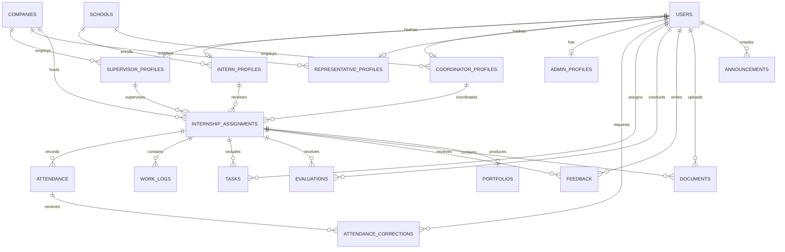
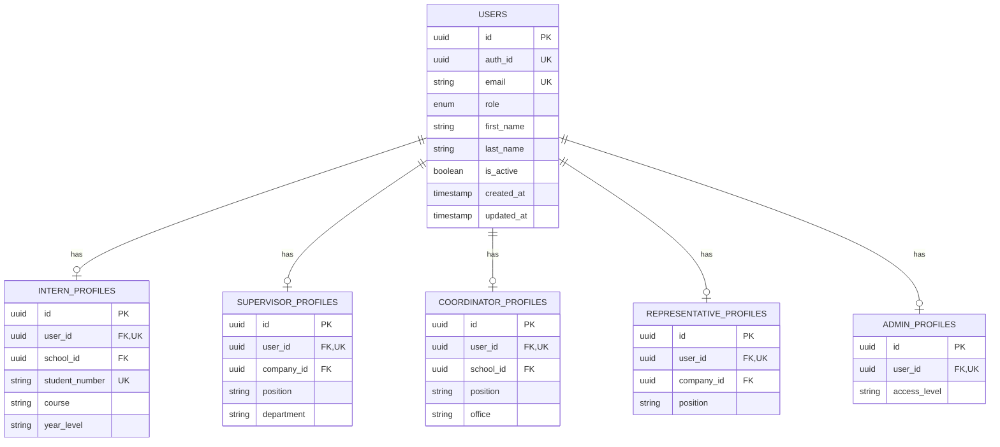
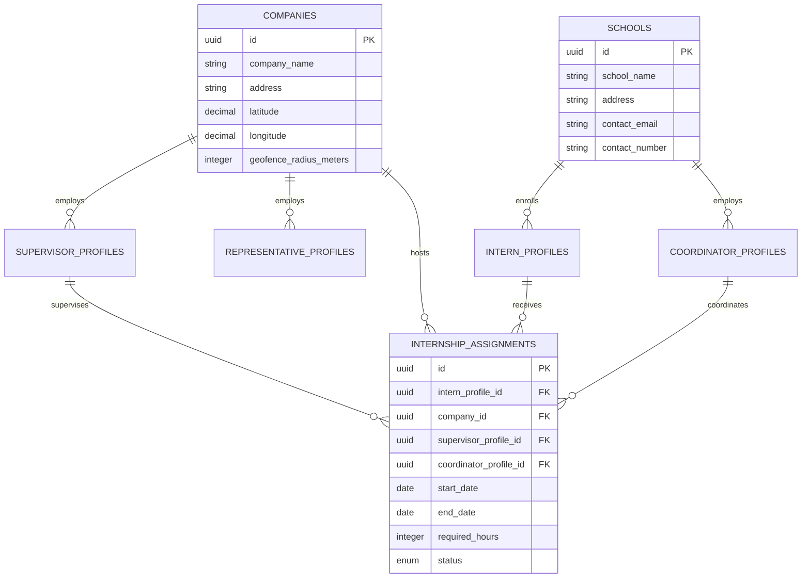
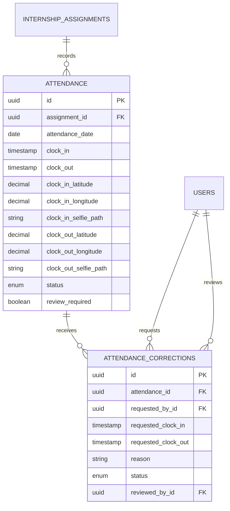
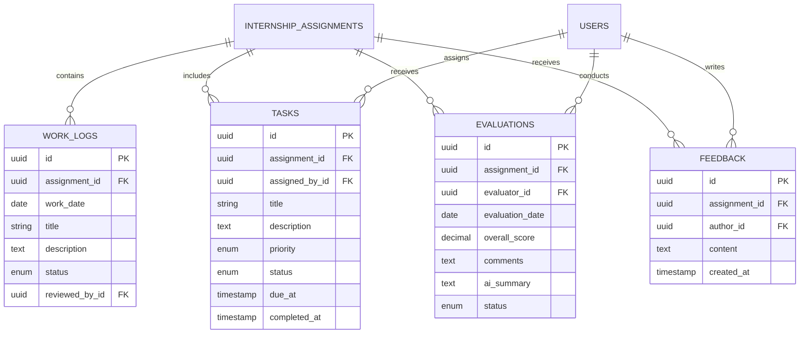
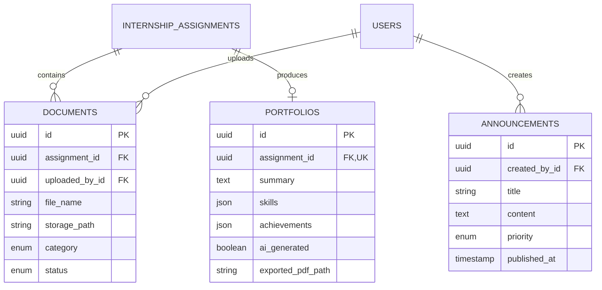

# Database Design

**Project:** IntelliTrack – AI-Powered Internship Management System

**Version:** 1.0

**Database:** PostgreSQL (Supabase)

**ORM:** Prisma ORM

---

# 1. Document Overview

## 1.1 Purpose

This document defines the logical database design of IntelliTrack, an AI-powered Internship Management System developed for Bo's Coffee.

It serves as the primary reference for implementing the application's data layer by defining the database architecture, entities, relationships, constraints, and business rules. The document also provides the foundation for the Prisma schema, database migrations, and backend development.

The database is designed to support internship management workflows while remaining scalable, maintainable, and aligned with modern software engineering practices.

---

## 1.2 Scope

This document covers the database design for all Version 1 modules of IntelliTrack.

Included modules:

- Authentication
- User Management
- Internship Management
- Attendance Management
- Work Logs
- Task Management
- Performance Evaluation
- Feedback
- Document Management
- Announcements
- AI-Assisted Portfolio Generation

The document excludes implementation-specific details such as SQL scripts and Prisma models, which will be covered in separate technical documents.

---

## 1.3 Related Documents

This database design should be read together with the following project documents:

| Document | Purpose |
|-----------|---------|
| Project Vision | Defines the project's goals and objectives |
| Core Requirements | Functional and non-functional requirements |
| Technology Stack | Selected technologies and development tools |
| Architecture | Overall system architecture |
| Design System | Visual language and UI consistency |
| UI/UX Specification | User flows and screen specifications |

---

# 2. Database Architecture

## 2.1 Technology Stack

| Component | Technology |
|------------|------------|
| Database Engine | PostgreSQL |
| Database Service | Supabase |
| ORM | Prisma ORM |
| Authentication | Supabase Auth |
| File Storage | Supabase Storage |

PostgreSQL was selected because it provides excellent relational capabilities, strong integrity constraints, indexing support, and seamless integration with Prisma ORM and Supabase.

---

## 2.2 Database Design Principles

The IntelliTrack database follows the following principles.

### 1. Normalized Design

Data is normalized to reduce redundancy while maintaining practical simplicity.

Role-specific information is separated from shared user information, resulting in a cleaner and more maintainable schema.

---

### 2. Single Source of Truth

Each piece of information should exist in only one place whenever possible.

Examples:

- User authentication data exists only in the `users` table.
- Company information exists only in the `companies` table.
- School information exists only in the `schools` table.

---

### 3. Separation of Concerns

Authentication data is separated from business data.

For example:

- User authentication belongs to the `users` table.
- Internship assignments belong to `internship_assignments`.
- Attendance belongs to `attendance`.

This separation improves maintainability and simplifies future expansion.

---

### 4. Historical Integrity

Internship records should never be overwritten.

Instead of replacing old assignments, new assignments are created while historical records remain available for reporting and portfolio generation.

---

### 5. Evidence-Based Attendance

Attendance records should store supporting evidence rather than relying solely on timestamps.

Each attendance record stores:

- Clock-in time
- Clock-out time
- GPS coordinates
- GPS accuracy
- Distance from company location
- Selfie image references
- Geofence validation result

This provides supervisors with sufficient evidence when reviewing attendance.

---

### 6. File Separation

Large files are not stored inside the database.

Instead:

- Selfies
- Documents
- Profile photos
- Portfolio exports

are stored in Supabase Storage.

The database stores only their corresponding file URLs or storage paths.

---

### 7. Future Scalability

The database should support future enhancements without requiring major structural changes.

Examples include:

- Mobile application
- Facial recognition
- Push notifications
- Calendar scheduling
- AI recommendations

---

## 2.3 Naming Conventions

The project follows consistent naming standards.

### Tables

- plural
- snake_case

Examples

```
users

companies

attendance

work_logs
```

---

### Columns

Use snake_case.

Examples

```
created_at

updated_at

clock_in

profile_photo_url
```

---

### Primary Keys

Every table contains a UUID primary key.

```
id UUID
```

---

### Foreign Keys

Foreign keys use the referenced table name followed by `_id`.

Examples

```
user_id

company_id

assignment_id

school_id
```

---

### Timestamp Columns

Every business table includes:

```
created_at

updated_at
```

---

### Enumerations

Application status values use enums instead of free-text strings.

Examples include:

- UserRole
- AttendanceStatus
- TaskStatus
- DocumentStatus

---

## 2.4 Database Modules

To improve maintainability, the database is organized into logical business modules.

### Authentication Module

Responsible for authentication and user identity.

Tables:

- users
- intern_profiles
- supervisor_profiles
- coordinator_profiles
- representative_profiles
- admin_profiles

---

### Internship Module

Responsible for internship placements.

Tables:

- schools
- companies
- internship_assignments

---

### Attendance Module

Responsible for attendance monitoring.

Tables:

- attendance
- attendance_corrections

---

### Work Management Module

Responsible for daily internship activities.

Tables:

- work_logs
- tasks
- evaluations
- feedback

---

### Content Module

Responsible for file and content management.

Tables:

- documents
- announcements
- portfolios

---

## 2.5 High-Level Database Architecture

```text
                    Users
                      │
        ┌─────────────┴─────────────┐
        │                           │
  Role Profiles              Authentication
        │
        ▼
Internship Assignments
        │
 ┌──────┼───────────────┐
 │      │               │
 ▼      ▼               ▼
Attendance        Work Logs      Tasks
 │                      │
 ▼                      ▼
Corrections      Evaluations
 │
 ▼
Feedback

Documents

Announcements

Portfolios
```

The database architecture follows a modular relational design where each business domain is isolated while maintaining clear relationships through foreign keys.

This approach keeps the schema organized, minimizes redundancy, and simplifies future maintenance.


---

# 3. Entity Relationship Diagram

## 3.1 ERD Overview

The IntelliTrack database uses a relational structure organized around the internship assignment.

The `users` table stores shared identity information, while role-specific profile tables contain information unique to interns, supervisors, coordinators, company representatives, and administrators.

The `internship_assignments` table connects an intern to a company, supervisor, and school coordinator. Operational records such as attendance, work logs, tasks, evaluations, feedback, documents, and portfolios are linked to an internship assignment.

---

## 3.2 Complete Entity Relationship Diagram



### Cardinality Legend

| Symbol | Meaning |
|---|---|
| `||` | Exactly one |
| `o|` | Zero or one |
| `o{` | Zero or many |
| `|{` | One or many |

---

## 3.3 Authentication and Role Profile ERD



A user may have only one role-specific profile consistent with the value stored in `users.role`.

For example:

- A user with the `INTERN` role has one `intern_profiles` record.
- A user with the `SUPERVISOR` role has one `supervisor_profiles` record.
- A user must not have multiple role-specific profiles in Version 1.

The application layer is responsible for enforcing this cross-table rule.

---

## 3.4 Internship Management ERD



The internship assignment is a historical business record. An intern can have multiple assignments over time, but only one assignment may have an `ACTIVE` status at a given time.

---

## 3.5 Attendance ERD



Each attendance record represents one internship attendance session for one date.

The record stores separate evidence for clock-in and clock-out:

- server timestamp
- latitude and longitude
- location accuracy
- distance from the company location
- geofence validation result
- selfie storage path

Attendance correction requests do not directly replace the original record. They preserve the requested values, reason, review decision, and reviewer for auditability.

---

## 3.6 Work Management ERD



These entities are connected to an internship assignment rather than directly to an intern. This ensures that records remain associated with the correct placement when an intern has multiple assignments over time.

---

## 3.7 Content and Portfolio ERD



One internship assignment has at most one portfolio in Version 1. The portfolio may be regenerated and updated without creating duplicate portfolio records.

---

# 4. Entity Catalog

## 4.1 Authentication Module

### `users`

Stores shared identity and account information for every system user.

This table corresponds to a Supabase Auth identity through `auth_id`. It does not store plaintext passwords or password hashes managed by Supabase Auth.

Primary responsibilities:

- connect application users to Supabase Auth
- store the user's fixed system role
- store shared personal information
- track account activation status
- provide a common reference for ownership and audit fields

---

### `intern_profiles`

Stores academic and internship-related identity information specific to an intern.

Primary responsibilities:

- identify the intern using a student number
- connect the intern to a school
- store course and year-level information
- store academic or emergency contact details
- serve as the parent entity for internship assignments

Internship placement details are not stored in this table. They belong to `internship_assignments` so that assignment history can be preserved.

---

### `supervisor_profiles`

Stores information specific to company supervisors.

Primary responsibilities:

- connect a supervisor to a company
- store the supervisor's department and position
- identify supervisors who may be assigned to interns
- support attendance, work-log, task, and evaluation review workflows

---

### `coordinator_profiles`

Stores information specific to school internship coordinators.

Primary responsibilities:

- connect a coordinator to a school
- store the coordinator's office and position
- identify the coordinator responsible for monitoring an assignment
- support school-level oversight and reporting

---

### `representative_profiles`

Stores information specific to company representatives.

Primary responsibilities:

- connect a representative to a company
- store the representative's organizational position
- support company-level oversight and document management

A company representative may have broader company visibility than an individual supervisor.

---

### `admin_profiles`

Stores administrator-specific information.

Primary responsibilities:

- identify application administrators
- optionally classify administrative access levels
- support system-level administration

Detailed permissions should be enforced through application authorization rather than relying only on `access_level`.

---

## 4.2 Internship Module

### `schools`

Stores educational institutions that send interns to partner companies.

Primary responsibilities:

- store school identity and contact information
- group intern and coordinator profiles
- support school-level reporting
- preserve institutional references across historical assignments

---

### `companies`

Stores companies or company branches that host interns.

Primary responsibilities:

- store company identity and contact information
- define the official attendance location
- define the permitted geofence radius
- group supervisors and representatives
- host internship assignments

For Version 1, each company record represents one attendance location. Multi-branch support may be introduced later through a separate `company_locations` table.

---

### `internship_assignments`

Represents a specific internship placement.

Primary responsibilities:

- connect an intern to a company
- assign a supervisor and school coordinator
- define the internship period
- define required internship hours
- preserve historical internship placement records
- serve as the parent record for operational modules

Most internship activity records reference this entity rather than directly referencing the intern or company.

---

## 4.3 Attendance Module

### `attendance`

Stores daily attendance sessions for internship assignments.

Primary responsibilities:

- record clock-in and clock-out timestamps
- store GPS evidence for both actions
- store selfie evidence for both actions
- record geofence validation results
- calculate attendance classifications
- identify records requiring supervisor review
- support internship-hour reporting

The record should use server-generated timestamps as the authoritative time. Device time may be collected for diagnostics but should not determine official attendance.

---

### `attendance_corrections`

Stores requests to correct attendance information.

Primary responsibilities:

- preserve the original attendance record
- capture the requested replacement values
- record the reason for the request
- support approval and rejection workflows
- identify the requesting user and reviewer
- preserve a review trail

Approved correction requests may update the corresponding attendance summary while retaining the correction record.

---

## 4.4 Work Management Module

### `work_logs`

Stores an intern's written record of completed internship activities.

Primary responsibilities:

- document work performed on a specific date
- support draft and submission workflows
- enable supervisor review
- contribute content to reports and portfolios
- preserve approved internship accomplishments

---

### `tasks`

Stores work assigned to an intern during an internship placement.

Primary responsibilities:

- record task title, description, and priority
- identify the assigning user
- define due dates
- track task progress and completion
- support dashboard reminders and progress reporting

Task status should be stored explicitly, while overdue state may be calculated from the due date when the task remains incomplete.

---

### `evaluations`

Stores formal performance evaluations for an internship assignment.

Primary responsibilities:

- identify the evaluator
- store evaluation date and overall score
- store evaluation comments
- track completion status
- optionally store an AI-assisted summary
- support performance reports and portfolio generation

Version 1 may use fixed evaluation criteria in the application. Reusable database-driven evaluation templates may be introduced later.

---

### `feedback`

Stores informal or continuous feedback related to an internship assignment.

Primary responsibilities:

- capture observations and recommendations
- identify the feedback author
- create a chronological feedback history
- provide information for intern development
- support portfolio and performance summaries

Feedback differs from evaluations because it is less formal and may occur repeatedly throughout an internship.

---

## 4.5 Content Module

### `documents`

Stores metadata for internship-related files uploaded to Supabase Storage.

Primary responsibilities:

- identify the internship assignment associated with a file
- identify the uploader
- classify the document
- store the Supabase Storage path
- track approval status
- preserve document remarks

The database does not store the actual binary file.

---

### `announcements`

Stores notices published to IntelliTrack users.

Primary responsibilities:

- store announcement title and content
- identify the announcement creator
- assign priority
- control publication timing
- communicate system, school, or company information

Version 1 may use role-based audience fields or application-level audience filtering. A more flexible audience mapping table may be added in a future version.

---

### `portfolios`

Stores the assembled internship portfolio for an assignment.

Primary responsibilities:

- store portfolio summary content
- store structured skill and achievement information
- indicate whether content was AI-assisted
- store the exported PDF path
- provide a persistent portfolio that can be edited and regenerated

AI-generated content must remain editable and should not replace user-approved content automatically.

---

## 4.6 Entity Responsibility Summary

| Entity | Module | Primary Owner or Context |
|---|---|---|
| `users` | Authentication | System account |
| `intern_profiles` | Authentication | Intern |
| `supervisor_profiles` | Authentication | Supervisor |
| `coordinator_profiles` | Authentication | Coordinator |
| `representative_profiles` | Authentication | Company representative |
| `admin_profiles` | Authentication | Administrator |
| `schools` | Internship | Educational institution |
| `companies` | Internship | Host company or branch |
| `internship_assignments` | Internship | Internship placement |
| `attendance` | Attendance | Internship assignment |
| `attendance_corrections` | Attendance | Attendance record |
| `work_logs` | Work Management | Internship assignment |
| `tasks` | Work Management | Internship assignment |
| `evaluations` | Work Management | Internship assignment |
| `feedback` | Work Management | Internship assignment |
| `documents` | Content | Internship assignment |
| `announcements` | Content | System communication |
| `portfolios` | Content | Internship assignment |

---

## 4.7 Core Ownership Model

The internship assignment is the primary business context for most operational data.

```text
Intern Profile
      │
      ▼
Internship Assignment
      │
      ├── Attendance
      ├── Attendance Corrections
      ├── Work Logs
      ├── Tasks
      ├── Evaluations
      ├── Feedback
      ├── Documents
      └── Portfolio
```

This structure ensures that:

- internship records remain historically accurate
- an intern's records are not mixed across placements
- reports can be generated per assignment
- company and supervisor changes do not overwrite previous records
- portfolio content can be traced to a specific internship experience

---

# 5. Authentication Module

## 5.1 Module Overview

The Authentication Module manages system identities, application roles, shared user information, and role-specific profiles.

Supabase Auth is responsible for:

- email and password authentication
- password hashing
- account recovery
- authentication sessions
- access and refresh tokens
- optional email verification

The IntelliTrack database stores application-specific user information in the `users` table.

The `users.auth_id` column references the UUID generated by Supabase Auth. IntelliTrack must never store plaintext passwords or duplicate Supabase password hashes.

```text
Supabase Auth User
        │
        │ auth_id
        ▼
      users
        │
        ├── intern_profiles
        ├── supervisor_profiles
        ├── coordinator_profiles
        ├── representative_profiles
        └── admin_profiles
```

---

## 5.2 `users` Table

### Purpose

The `users` table stores the shared identity, application role, contact information, and account status of every IntelliTrack user.

Each application user must correspond to exactly one Supabase Auth identity.

### Column Specification

| Column | PostgreSQL Type | Required | Key | Default | Description |
|---|---|---:|---|---|---|
| `id` | `UUID` | Yes | PK | `gen_random_uuid()` | Internal application user identifier |
| `auth_id` | `UUID` | Yes | UK | None | Supabase Auth user identifier |
| `email` | `VARCHAR(255)` | Yes | UK | None | User's normalized email address |
| `role` | `user_role` | Yes | — | None | Primary application role |
| `first_name` | `VARCHAR(100)` | Yes | — | None | User's first name |
| `middle_name` | `VARCHAR(100)` | No | — | `NULL` | User's middle name |
| `last_name` | `VARCHAR(100)` | Yes | — | None | User's last name |
| `suffix` | `VARCHAR(20)` | No | — | `NULL` | Name suffix such as Jr. or III |
| `phone_number` | `VARCHAR(30)` | No | — | `NULL` | User's contact number |
| `profile_photo_path` | `TEXT` | No | — | `NULL` | Supabase Storage path for the profile photo |
| `is_active` | `BOOLEAN` | Yes | — | `TRUE` | Indicates whether application access is enabled |
| `last_login_at` | `TIMESTAMPTZ` | No | — | `NULL` | Most recent successful login timestamp |
| `created_at` | `TIMESTAMPTZ` | Yes | — | `NOW()` | Record creation timestamp |
| `updated_at` | `TIMESTAMPTZ` | Yes | — | `NOW()` | Record update timestamp |

### Primary Key

```text
users.id
```

### Unique Constraints

```text
UNIQUE (auth_id)

UNIQUE (email)
```

Email uniqueness should be treated as case-insensitive. This may be implemented using one of the following strategies:

- PostgreSQL `CITEXT`
- a unique index on `LOWER(email)`
- application-level normalization before insertion

The recommended Version 1 approach is to convert email addresses to lowercase before saving them.

### Check Constraints

```text
first_name must not be empty

last_name must not be empty

email must not be empty
```

Suggested logical checks:

```sql
CHECK (length(trim(first_name)) > 0)

CHECK (length(trim(last_name)) > 0)

CHECK (length(trim(email)) > 0)
```

### Relationships

| Related Table | Relationship | Foreign Key Location |
|---|---|---|
| `intern_profiles` | One user to zero or one intern profile | `intern_profiles.user_id` |
| `supervisor_profiles` | One user to zero or one supervisor profile | `supervisor_profiles.user_id` |
| `coordinator_profiles` | One user to zero or one coordinator profile | `coordinator_profiles.user_id` |
| `representative_profiles` | One user to zero or one representative profile | `representative_profiles.user_id` |
| `admin_profiles` | One user to zero or one admin profile | `admin_profiles.user_id` |
| `tasks` | One user may assign many tasks | `tasks.assigned_by_id` |
| `evaluations` | One user may conduct many evaluations | `evaluations.evaluator_id` |
| `feedback` | One user may write many feedback records | `feedback.author_id` |
| `documents` | One user may upload many documents | `documents.uploaded_by_id` |
| `announcements` | One user may create many announcements | `announcements.created_by_id` |

### Deletion Behavior

A user record should not normally be physically deleted when historical records depend on it.

Recommended behavior:

```text
User deactivation:
Set users.is_active = false

Profile relationship:
ON DELETE CASCADE

Historical authored records:
ON DELETE RESTRICT or SET NULL, depending on the field
```

Deleting the related Supabase Auth account must be coordinated with application-level deactivation or archival.

### Recommended Indexes

| Index | Columns | Type | Reason |
|---|---|---|---|
| `users_auth_id_key` | `auth_id` | Unique | Supabase Auth lookup |
| `users_email_key` | `email` | Unique | Login and identity lookup |
| `users_role_idx` | `role` | Standard | Role-based user listing |
| `users_active_role_idx` | `is_active`, `role` | Composite | Active users filtered by role |
| `users_last_name_idx` | `last_name` | Standard | User search and sorting |

---

## 5.3 `intern_profiles` Table

### Purpose

The `intern_profiles` table stores academic and personal information that applies only to users with the `INTERN` role.

Internship placement details are intentionally excluded. They belong to `internship_assignments`.

### Column Specification

| Column | PostgreSQL Type | Required | Key | Default | Description |
|---|---|---:|---|---|---|
| `id` | `UUID` | Yes | PK | `gen_random_uuid()` | Intern profile identifier |
| `user_id` | `UUID` | Yes | FK, UK | None | References the associated user |
| `school_id` | `UUID` | Yes | FK | None | References the intern's school |
| `student_number` | `VARCHAR(100)` | Yes | UK | None | School-issued student identifier |
| `course` | `VARCHAR(150)` | Yes | — | None | Degree or academic program |
| `year_level` | `VARCHAR(50)` | No | — | `NULL` | Current academic year level |
| `section` | `VARCHAR(50)` | No | — | `NULL` | Academic section or block |
| `date_of_birth` | `DATE` | No | — | `NULL` | Intern's date of birth |
| `address` | `TEXT` | No | — | `NULL` | Residential address |
| `emergency_contact_name` | `VARCHAR(200)` | No | — | `NULL` | Emergency contact's full name |
| `emergency_contact_number` | `VARCHAR(30)` | No | — | `NULL` | Emergency contact number |
| `emergency_contact_relationship` | `VARCHAR(100)` | No | — | `NULL` | Relationship to the intern |
| `created_at` | `TIMESTAMPTZ` | Yes | — | `NOW()` | Record creation timestamp |
| `updated_at` | `TIMESTAMPTZ` | Yes | — | `NOW()` | Record update timestamp |

### Foreign Keys

```text
user_id → users.id

school_id → schools.id
```

### Unique Constraints

```text
UNIQUE (user_id)

UNIQUE (student_number)
```

If student numbers are only unique within a school, the implementation may instead use:

```text
UNIQUE (school_id, student_number)
```

For IntelliTrack Version 1, the recommended constraint is:

```text
UNIQUE (school_id, student_number)
```

This avoids conflicts when different schools issue identical student-number formats.

### Business Constraints

- `user_id` must reference a user whose role is `INTERN`.
- One user may have only one intern profile.
- An intern profile may have multiple internship assignments over time.
- The school relationship must remain available for historical reporting.

The role-to-profile consistency rule must be validated by the application service because a standard foreign key cannot ensure that `users.role = INTERN`.

### Deletion Behavior

```text
user_id:
ON DELETE CASCADE

school_id:
ON DELETE RESTRICT
```

A school should not be deleted while intern profiles reference it. It should be marked inactive instead.

### Recommended Indexes

| Index | Columns | Type | Reason |
|---|---|---|---|
| `intern_profiles_user_id_key` | `user_id` | Unique | User-to-profile lookup |
| `intern_profiles_school_student_key` | `school_id`, `student_number` | Unique | School-scoped student identity |
| `intern_profiles_school_id_idx` | `school_id` | Standard | School intern listing |
| `intern_profiles_course_idx` | `course` | Standard | Course-based reporting |

---

## 5.4 `supervisor_profiles` Table

### Purpose

The `supervisor_profiles` table stores company employment information specific to users who directly supervise interns.

### Column Specification

| Column | PostgreSQL Type | Required | Key | Default | Description |
|---|---|---:|---|---|---|
| `id` | `UUID` | Yes | PK | `gen_random_uuid()` | Supervisor profile identifier |
| `user_id` | `UUID` | Yes | FK, UK | None | References the associated user |
| `company_id` | `UUID` | Yes | FK | None | References the supervisor's company |
| `employee_number` | `VARCHAR(100)` | No | — | `NULL` | Internal company employee identifier |
| `position` | `VARCHAR(150)` | Yes | — | None | Job title or position |
| `department` | `VARCHAR(150)` | No | — | `NULL` | Company department |
| `office_location` | `VARCHAR(255)` | No | — | `NULL` | Office or work location description |
| `created_at` | `TIMESTAMPTZ` | Yes | — | `NOW()` | Record creation timestamp |
| `updated_at` | `TIMESTAMPTZ` | Yes | — | `NOW()` | Record update timestamp |

### Foreign Keys

```text
user_id → users.id

company_id → companies.id
```

### Unique Constraints

```text
UNIQUE (user_id)
```

When employee numbers are used, they should generally be unique within a company:

```text
UNIQUE (company_id, employee_number)
```

Because `employee_number` is optional, this constraint should allow multiple `NULL` values.

### Business Constraints

- `user_id` must reference a user whose role is `SUPERVISOR`.
- One supervisor profile belongs to one company in Version 1.
- A supervisor may supervise many internship assignments.
- A supervisor may review attendance, work logs, tasks, and evaluations only within authorized assignments.

### Deletion Behavior

```text
user_id:
ON DELETE CASCADE

company_id:
ON DELETE RESTRICT
```

A supervisor assigned to historical internship records should be deactivated rather than deleted.

### Recommended Indexes

| Index | Columns | Type | Reason |
|---|---|---|---|
| `supervisor_profiles_user_id_key` | `user_id` | Unique | User-to-profile lookup |
| `supervisor_profiles_company_id_idx` | `company_id` | Standard | Company supervisor listing |
| `supervisor_profiles_company_department_idx` | `company_id`, `department` | Composite | Department-level filtering |

---

## 5.5 `coordinator_profiles` Table

### Purpose

The `coordinator_profiles` table stores institution-related information for users responsible for coordinating and monitoring interns from a school.

### Column Specification

| Column | PostgreSQL Type | Required | Key | Default | Description |
|---|---|---:|---|---|---|
| `id` | `UUID` | Yes | PK | `gen_random_uuid()` | Coordinator profile identifier |
| `user_id` | `UUID` | Yes | FK, UK | None | References the associated user |
| `school_id` | `UUID` | Yes | FK | None | References the coordinator's school |
| `employee_number` | `VARCHAR(100)` | No | — | `NULL` | School-issued employee identifier |
| `position` | `VARCHAR(150)` | Yes | — | None | Coordinator's official position |
| `department` | `VARCHAR(150)` | No | — | `NULL` | Academic department |
| `office` | `VARCHAR(150)` | No | — | `NULL` | Office location or designation |
| `created_at` | `TIMESTAMPTZ` | Yes | — | `NOW()` | Record creation timestamp |
| `updated_at` | `TIMESTAMPTZ` | Yes | — | `NOW()` | Record update timestamp |

### Foreign Keys

```text
user_id → users.id

school_id → schools.id
```

### Unique Constraints

```text
UNIQUE (user_id)
```

Optional school-scoped employee number:

```text
UNIQUE (school_id, employee_number)
```

### Business Constraints

- `user_id` must reference a user whose role is `COORDINATOR`.
- One coordinator belongs to one school in Version 1.
- A coordinator may monitor many internship assignments.
- A coordinator should only access interns associated with their school unless elevated authorization is granted.

### Deletion Behavior

```text
user_id:
ON DELETE CASCADE

school_id:
ON DELETE RESTRICT
```

### Recommended Indexes

| Index | Columns | Type | Reason |
|---|---|---|---|
| `coordinator_profiles_user_id_key` | `user_id` | Unique | User-to-profile lookup |
| `coordinator_profiles_school_id_idx` | `school_id` | Standard | School coordinator listing |
| `coordinator_profiles_school_department_idx` | `school_id`, `department` | Composite | Department-level filtering |

---

## 5.6 `representative_profiles` Table

### Purpose

The `representative_profiles` table stores company information specific to company representatives who oversee internship coordination at an organizational level.

### Column Specification

| Column | PostgreSQL Type | Required | Key | Default | Description |
|---|---|---:|---|---|---|
| `id` | `UUID` | Yes | PK | `gen_random_uuid()` | Representative profile identifier |
| `user_id` | `UUID` | Yes | FK, UK | None | References the associated user |
| `company_id` | `UUID` | Yes | FK | None | References the representative's company |
| `employee_number` | `VARCHAR(100)` | No | — | `NULL` | Internal company employee identifier |
| `position` | `VARCHAR(150)` | Yes | — | None | Representative's job title |
| `department` | `VARCHAR(150)` | No | — | `NULL` | Representative's department |
| `created_at` | `TIMESTAMPTZ` | Yes | — | `NOW()` | Record creation timestamp |
| `updated_at` | `TIMESTAMPTZ` | Yes | — | `NOW()` | Record update timestamp |

### Foreign Keys

```text
user_id → users.id

company_id → companies.id
```

### Unique Constraints

```text
UNIQUE (user_id)
```

Optional company-scoped employee identity:

```text
UNIQUE (company_id, employee_number)
```

### Business Constraints

- `user_id` must reference a user whose role is `REPRESENTATIVE`.
- One representative belongs to one company in Version 1.
- A company may have multiple representatives.
- Representatives may have company-wide visibility but should not automatically gain system-wide access.

### Deletion Behavior

```text
user_id:
ON DELETE CASCADE

company_id:
ON DELETE RESTRICT
```

### Recommended Indexes

| Index | Columns | Type | Reason |
|---|---|---|---|
| `representative_profiles_user_id_key` | `user_id` | Unique | User-to-profile lookup |
| `representative_profiles_company_id_idx` | `company_id` | Standard | Company representative listing |

---

## 5.7 `admin_profiles` Table

### Purpose

The `admin_profiles` table stores administrator-specific metadata that does not belong in the shared `users` table.

### Column Specification

| Column | PostgreSQL Type | Required | Key | Default | Description |
|---|---|---:|---|---|---|
| `id` | `UUID` | Yes | PK | `gen_random_uuid()` | Administrator profile identifier |
| `user_id` | `UUID` | Yes | FK, UK | None | References the associated user |
| `access_level` | `admin_access_level` | Yes | — | `STANDARD` | Administrative access classification |
| `designation` | `VARCHAR(150)` | No | — | `NULL` | Administrator's organizational designation |
| `notes` | `TEXT` | No | — | `NULL` | Internal administrative notes |
| `created_at` | `TIMESTAMPTZ` | Yes | — | `NOW()` | Record creation timestamp |
| `updated_at` | `TIMESTAMPTZ` | Yes | — | `NOW()` | Record update timestamp |

### Foreign Keys

```text
user_id → users.id
```

### Unique Constraints

```text
UNIQUE (user_id)
```

### Business Constraints

- `user_id` must reference a user whose role is `ADMIN`.
- One user may have only one admin profile.
- Administrative authorization must be validated by backend policies.
- `access_level` should not replace permission checks in application services.

### Deletion Behavior

```text
user_id:
ON DELETE CASCADE
```

### Recommended Indexes

| Index | Columns | Type | Reason |
|---|---|---|---|
| `admin_profiles_user_id_key` | `user_id` | Unique | User-to-profile lookup |
| `admin_profiles_access_level_idx` | `access_level` | Standard | Administrative access filtering |

---

## 5.8 Authentication Module Business Rules

### User Identity Rules

1. Every IntelliTrack application user must have exactly one record in `users`.
2. Every `users.auth_id` must correspond to one Supabase Auth identity.
3. Passwords must not be stored in IntelliTrack application tables.
4. Email addresses must be normalized before storage.
5. Deactivated users must not be permitted to access protected application features.

### Role Rules

1. Each user has exactly one Version 1 role.
2. The user's profile table must match `users.role`.
3. A user must not have profiles in multiple role-specific tables.
4. Changing a user's role requires a controlled migration of profile data.
5. Role values must use the `user_role` enumeration.

### Profile Rules

| User Role | Required Profile |
|---|---|
| `INTERN` | `intern_profiles` |
| `SUPERVISOR` | `supervisor_profiles` |
| `COORDINATOR` | `coordinator_profiles` |
| `REPRESENTATIVE` | `representative_profiles` |
| `ADMIN` | `admin_profiles` |

### Account Deactivation Rules

Deactivation should use:

```text
users.is_active = false
```

rather than deleting the record.

Deactivation preserves:

- internship history
- attendance approvals
- task assignments
- evaluations
- feedback authorship
- uploaded-document ownership
- announcement authorship

---

# 6. Internship Module

## 6.1 Module Overview

The Internship Module represents the organizations and relationships involved in an internship placement.

Its central entity is `internship_assignments`.

```text
School
  │
  ├── Intern
  └── Coordinator
          │
          ▼
Internship Assignment
          ▲
          │
  ┌───────┴────────┐
  │                │
Company        Supervisor
```

An internship assignment connects:

- one intern
- one host company
- one company supervisor
- one school coordinator
- one internship period
- one required-hours target

---

## 6.2 `schools` Table

### Purpose

The `schools` table stores educational institutions that participate in the internship program.

### Column Specification

| Column | PostgreSQL Type | Required | Key | Default | Description |
|---|---|---:|---|---|---|
| `id` | `UUID` | Yes | PK | `gen_random_uuid()` | School identifier |
| `school_code` | `VARCHAR(50)` | No | UK | `NULL` | Short institutional code |
| `name` | `VARCHAR(255)` | Yes | — | None | Official school name |
| `address_line` | `TEXT` | No | — | `NULL` | Street or full address |
| `city` | `VARCHAR(100)` | No | — | `NULL` | City or municipality |
| `province` | `VARCHAR(100)` | No | — | `NULL` | Province or region |
| `postal_code` | `VARCHAR(20)` | No | — | `NULL` | Postal code |
| `contact_email` | `VARCHAR(255)` | No | — | `NULL` | Main school contact email |
| `contact_number` | `VARCHAR(30)` | No | — | `NULL` | Main contact number |
| `website_url` | `TEXT` | No | — | `NULL` | School website |
| `logo_path` | `TEXT` | No | — | `NULL` | Supabase Storage path for the logo |
| `is_active` | `BOOLEAN` | Yes | — | `TRUE` | Indicates whether the school is active |
| `created_at` | `TIMESTAMPTZ` | Yes | — | `NOW()` | Record creation timestamp |
| `updated_at` | `TIMESTAMPTZ` | Yes | — | `NOW()` | Record update timestamp |

### Unique Constraints

```text
UNIQUE (school_code)
```

School-name uniqueness should not necessarily be enforced globally because institutions may have multiple campuses with similar names.

If each campus is represented separately, the full official name or campus name should be included in `name`.

### Relationships

| Related Table | Relationship |
|---|---|
| `intern_profiles` | One school has many interns |
| `coordinator_profiles` | One school has many coordinators |
| `internship_assignments` | Indirectly associated through interns and coordinators |

### Deletion Behavior

Schools with historical relationships must not be physically deleted.

Recommended approach:

```text
is_active = false
```

Foreign keys referencing schools should use:

```text
ON DELETE RESTRICT
```

### Recommended Indexes

| Index | Columns | Type | Reason |
|---|---|---|---|
| `schools_school_code_key` | `school_code` | Unique | Institutional code lookup |
| `schools_name_idx` | `name` | Standard | Name search and sorting |
| `schools_is_active_idx` | `is_active` | Standard | Active-school filtering |
| `schools_city_idx` | `city` | Standard | Location filtering |

---

## 6.3 `companies` Table

### Purpose

The `companies` table stores host organizations or branches where internships take place.

For Version 1, each company record represents one primary attendance location.

If Bo's Coffee internships occur at multiple branches, each branch should be represented by its own company record or branch-specific company record.

### Column Specification

| Column | PostgreSQL Type | Required | Key | Default | Description |
|---|---|---:|---|---|---|
| `id` | `UUID` | Yes | PK | `gen_random_uuid()` | Company or branch identifier |
| `company_code` | `VARCHAR(50)` | No | UK | `NULL` | Internal company or branch code |
| `name` | `VARCHAR(255)` | Yes | — | None | Official company or branch name |
| `branch_name` | `VARCHAR(255)` | No | — | `NULL` | Branch-specific name |
| `address_line` | `TEXT` | Yes | — | None | Primary street address |
| `city` | `VARCHAR(100)` | No | — | `NULL` | City or municipality |
| `province` | `VARCHAR(100)` | No | — | `NULL` | Province or region |
| `postal_code` | `VARCHAR(20)` | No | — | `NULL` | Postal code |
| `contact_email` | `VARCHAR(255)` | No | — | `NULL` | Official contact email |
| `contact_number` | `VARCHAR(30)` | No | — | `NULL` | Official contact number |
| `latitude` | `DECIMAL(10,7)` | Yes | — | None | Official attendance latitude |
| `longitude` | `DECIMAL(10,7)` | Yes | — | None | Official attendance longitude |
| `geofence_radius_meters` | `INTEGER` | Yes | — | `100` | Allowed distance from company coordinates |
| `timezone` | `VARCHAR(100)` | Yes | — | `'Asia/Manila'` | Timezone used for schedules and attendance |
| `logo_path` | `TEXT` | No | — | `NULL` | Supabase Storage path for company logo |
| `is_active` | `BOOLEAN` | Yes | — | `TRUE` | Indicates whether the company location is active |
| `created_at` | `TIMESTAMPTZ` | Yes | — | `NOW()` | Record creation timestamp |
| `updated_at` | `TIMESTAMPTZ` | Yes | — | `NOW()` | Record update timestamp |

### Unique Constraints

```text
UNIQUE (company_code)
```

The combination of company and branch name may optionally be unique:

```text
UNIQUE (name, branch_name)
```

This constraint should be considered carefully because `branch_name` may be `NULL`.

### Check Constraints

```sql
CHECK (latitude >= -90 AND latitude <= 90)

CHECK (longitude >= -180 AND longitude <= 180)

CHECK (geofence_radius_meters > 0)
```

A practical geofence range may also be enforced:

```sql
CHECK (
  geofence_radius_meters >= 20
  AND geofence_radius_meters <= 5000
)
```

### Relationships

| Related Table | Relationship |
|---|---|
| `supervisor_profiles` | One company has many supervisors |
| `representative_profiles` | One company has many representatives |
| `internship_assignments` | One company hosts many assignments |

### Geofence Responsibility

The company coordinates are the reference point for attendance validation.

During clock-in or clock-out, the system calculates the distance between:

```text
Company latitude and longitude

and

Intern device latitude and longitude
```

The resulting distance is compared with:

```text
companies.geofence_radius_meters
```

The calculated result must also be stored in the attendance record so historical evidence does not change if company coordinates are edited later.

### Deletion Behavior

Companies with historical assignments must not be deleted.

Recommended approach:

```text
companies.is_active = false
```

Dependent foreign keys should use:

```text
ON DELETE RESTRICT
```

### Recommended Indexes

| Index | Columns | Type | Reason |
|---|---|---|---|
| `companies_company_code_key` | `company_code` | Unique | Company or branch lookup |
| `companies_name_idx` | `name` | Standard | Company search and sorting |
| `companies_active_idx` | `is_active` | Standard | Active-company filtering |
| `companies_city_idx` | `city` | Standard | Geographic filtering |
| `companies_name_branch_idx` | `name`, `branch_name` | Composite | Branch identification |

---

## 6.4 `internship_assignments` Table

### Purpose

The `internship_assignments` table represents a formal internship placement.

It is the central business entity for IntelliTrack operational data.

Attendance, work logs, tasks, evaluations, feedback, documents, and portfolios should reference the assignment rather than directly referencing the intern.

### Column Specification

| Column | PostgreSQL Type | Required | Key | Default | Description |
|---|---|---:|---|---|---|
| `id` | `UUID` | Yes | PK | `gen_random_uuid()` | Internship assignment identifier |
| `intern_profile_id` | `UUID` | Yes | FK | None | Assigned intern |
| `company_id` | `UUID` | Yes | FK | None | Host company or branch |
| `supervisor_profile_id` | `UUID` | Yes | FK | None | Assigned company supervisor |
| `coordinator_profile_id` | `UUID` | Yes | FK | None | Assigned school coordinator |
| `assignment_code` | `VARCHAR(100)` | Yes | UK | None | Human-readable assignment identifier |
| `position_title` | `VARCHAR(150)` | No | — | `NULL` | Internship position or designation |
| `department` | `VARCHAR(150)` | No | — | `NULL` | Assigned department |
| `start_date` | `DATE` | Yes | — | None | Official internship start date |
| `end_date` | `DATE` | Yes | — | None | Official internship end date |
| `required_hours` | `INTEGER` | Yes | — | None | Required internship hours |
| `rendered_hours` | `DECIMAL(10,2)` | Yes | — | `0` | Cached approved hours, if maintained |
| `schedule_start_time` | `TIME` | No | — | `NULL` | Expected daily start time |
| `schedule_end_time` | `TIME` | No | — | `NULL` | Expected daily end time |
| `grace_period_minutes` | `INTEGER` | Yes | — | `0` | Allowed lateness before classification |
| `status` | `internship_status` | Yes | — | `PENDING` | Assignment lifecycle status |
| `notes` | `TEXT` | No | — | `NULL` | Administrative assignment notes |
| `activated_at` | `TIMESTAMPTZ` | No | — | `NULL` | Timestamp when assignment became active |
| `completed_at` | `TIMESTAMPTZ` | No | — | `NULL` | Timestamp when assignment was completed |
| `created_by_id` | `UUID` | No | FK | `NULL` | User who created the assignment |
| `created_at` | `TIMESTAMPTZ` | Yes | — | `NOW()` | Record creation timestamp |
| `updated_at` | `TIMESTAMPTZ` | Yes | — | `NOW()` | Record update timestamp |

### Foreign Keys

```text
intern_profile_id → intern_profiles.id

company_id → companies.id

supervisor_profile_id → supervisor_profiles.id

coordinator_profile_id → coordinator_profiles.id

created_by_id → users.id
```

### Unique Constraints

```text
UNIQUE (assignment_code)
```

Only one active assignment should be permitted for an intern at a time.

PostgreSQL can enforce this using a partial unique index:

```sql
CREATE UNIQUE INDEX internship_assignments_one_active_per_intern
ON internship_assignments (intern_profile_id)
WHERE status = 'ACTIVE';
```

Prisma does not directly represent every partial-index feature in its schema language. This index may need to be added through a custom SQL migration.

### Check Constraints

```sql
CHECK (end_date >= start_date)

CHECK (required_hours > 0)

CHECK (rendered_hours >= 0)

CHECK (grace_period_minutes >= 0)
```

When both schedule values exist:

```text
schedule_end_time must be later than schedule_start_time
```

This rule may be validated by the application because overnight schedules may be introduced later.

### Assignment Status Lifecycle

Recommended statuses:

```text
PENDING
    ↓
ACTIVE
    ↓
COMPLETED
```

Alternative terminal states:

```text
CANCELLED

TERMINATED
```

Valid transition examples:

| Current Status | Allowed Next Status |
|---|---|
| `PENDING` | `ACTIVE`, `CANCELLED` |
| `ACTIVE` | `COMPLETED`, `TERMINATED` |
| `COMPLETED` | None under normal operation |
| `CANCELLED` | None |
| `TERMINATED` | None |

Reopening a completed assignment should require an administrator-controlled process.

### Relationship Validation Rules

Before creating or activating an assignment, the application must verify that:

1. The intern belongs to an active school.
2. The coordinator belongs to the same school as the intern.
3. The supervisor belongs to the selected company.
4. The company is active.
5. The intern does not already have another active assignment.
6. The start date is not after the end date.
7. Required hours are greater than zero.

These cross-table rules cannot all be represented using ordinary foreign keys and must be enforced in the application layer or database triggers.

### Rendered Hours Strategy

Two implementation approaches are possible.

#### Option A — Calculate When Requested

Calculate rendered hours from approved attendance records whenever a report is requested.

Advantages:

- always derived from source records
- no synchronization problem
- simpler integrity model

Disadvantages:

- potentially more expensive for large reports

#### Option B — Store Cached Total

Maintain `rendered_hours` whenever attendance is approved or corrected.

Advantages:

- faster dashboards
- faster progress calculations

Disadvantages:

- requires careful synchronization
- may become inconsistent if updates fail

For Version 1, the recommended source of truth is approved attendance records.

If `rendered_hours` is retained, it must be treated as a cached value rather than the authoritative source.

### Deletion Behavior

Internship assignments should never be hard-deleted after operational records have been created.

Recommended behavior:

```text
Pending assignment with no related records:
May be deleted by an administrator

Active or historical assignment:
Update status instead of deleting
```

Recommended foreign-key actions:

| Foreign Key | Delete Action |
|---|---|
| `intern_profile_id` | `RESTRICT` |
| `company_id` | `RESTRICT` |
| `supervisor_profile_id` | `RESTRICT` |
| `coordinator_profile_id` | `RESTRICT` |
| `created_by_id` | `SET NULL` |

### Recommended Indexes

| Index | Columns | Type | Reason |
|---|---|---|---|
| `internship_assignments_code_key` | `assignment_code` | Unique | Direct assignment lookup |
| `internship_assignments_intern_idx` | `intern_profile_id` | Standard | Intern assignment history |
| `internship_assignments_company_idx` | `company_id` | Standard | Company assignment listing |
| `internship_assignments_supervisor_idx` | `supervisor_profile_id` | Standard | Supervisor workload listing |
| `internship_assignments_coordinator_idx` | `coordinator_profile_id` | Standard | Coordinator monitoring list |
| `internship_assignments_status_idx` | `status` | Standard | Status filtering |
| `internship_assignments_dates_idx` | `start_date`, `end_date` | Composite | Active-period and report queries |
| `internship_assignments_company_status_idx` | `company_id`, `status` | Composite | Active interns per company |
| `internship_assignments_supervisor_status_idx` | `supervisor_profile_id`, `status` | Composite | Active supervisee queries |

---

## 6.5 Internship Assignment Ownership Model

Operational records should reference `internship_assignments.id`.

```text
internship_assignments
        │
        ├── attendance.assignment_id
        ├── work_logs.assignment_id
        ├── tasks.assignment_id
        ├── evaluations.assignment_id
        ├── feedback.assignment_id
        ├── documents.assignment_id
        └── portfolios.assignment_id
```

This prevents records from different internships from being mixed together.

For example, when an intern completes one placement and begins another:

```text
Intern Profile
    │
    ├── Assignment A — Completed
    │      ├── Attendance
    │      ├── Work Logs
    │      └── Portfolio
    │
    └── Assignment B — Active
           ├── Attendance
           ├── Tasks
           └── Work Logs
```

The intern keeps one profile, while each placement has an independent operational history.

---

## 6.6 Internship Module Business Rules

### School Rules

1. Schools with historical records must be deactivated rather than deleted.
2. Each intern must belong to one school in Version 1.
3. Each coordinator must belong to one school in Version 1.
4. A coordinator should supervise assignments only for interns from the same school.

### Company Rules

1. Companies with historical assignments must be deactivated rather than deleted.
2. Company latitude and longitude must be valid geographic coordinates.
3. The geofence radius must be greater than zero.
4. A supervisor must belong to the company used by the assignment.
5. Company location changes must not modify stored historical attendance evidence.

### Assignment Rules

1. Every internship assignment must reference one intern.
2. Every internship assignment must reference one company.
3. Every internship assignment must reference one supervisor.
4. Every internship assignment must reference one coordinator.
5. The assignment end date must not precede the start date.
6. Required internship hours must be greater than zero.
7. An intern may have many historical assignments.
8. An intern may have only one active assignment at a time.
9. Operational records must reference the correct assignment.
10. Completed assignments must remain available for reports and portfolios.

---

## 6.7 Authentication and Internship Data Flow

```text
Administrator creates Supabase Auth user
                    │
                    ▼
              Create users row
                    │
                    ▼
        Create role-specific profile
                    │
          ┌─────────┴─────────┐
          │                   │
     Intern Profile      Staff Profile
          │                   │
          └─────────┬─────────┘
                    ▼
          Internship Assignment
                    │
                    ▼
         Operational Module Records
```

The user and role-specific profile must exist before an internship assignment can be created.

An assignment must exist before the system can create:

- attendance records
- work logs
- tasks
- evaluations
- feedback
- assignment documents
- portfolios

---

# 7. Attendance Module

## 7.1 Module Overview

The Attendance Module records and verifies the intern's daily attendance during an active internship assignment.

Version 1 uses the following attendance evidence:

- server-generated timestamps
- device GPS coordinates
- GPS accuracy
- calculated distance from the company location
- geofence validation
- selfie capture
- supervisor review when required

Version 1 does not include:

- facial recognition
- dynamic QR codes
- company Wi-Fi verification
- biometric identity matching
- automated anti-spoof detection

The primary goal is to provide practical attendance evidence without introducing unnecessary technical complexity.

```text
Internship Assignment
          │
          ▼
     Clock-In Request
          │
          ├── Server Timestamp
          ├── GPS Coordinates
          ├── GPS Accuracy
          ├── Geofence Validation
          └── Selfie Evidence
          │
          ▼
      Attendance Record
          │
          ▼
     Clock-Out Request
          │
          ├── Server Timestamp
          ├── GPS Coordinates
          ├── GPS Accuracy
          ├── Geofence Validation
          └── Selfie Evidence
          │
          ▼
  Verification and Review
```

---

## 7.2 Attendance Data Flow

### Clock-In Flow

```text
Intern selects Clock In
          │
          ▼
Application verifies active assignment
          │
          ▼
Application obtains GPS coordinates
          │
          ▼
Application captures selfie
          │
          ▼
Server receives clock-in request
          │
          ▼
Server retrieves company coordinates
          │
          ▼
Server calculates distance
          │
          ▼
Server determines geofence result
          │
          ▼
Server creates attendance record
```

### Clock-Out Flow

```text
Intern selects Clock Out
          │
          ▼
Application finds open attendance record
          │
          ▼
Application obtains GPS coordinates
          │
          ▼
Application captures selfie
          │
          ▼
Server receives clock-out request
          │
          ▼
Server calculates distance
          │
          ▼
Server determines geofence result
          │
          ▼
Server updates attendance record
          │
          ▼
System calculates worked duration
          │
          ▼
Record is approved automatically
or sent for supervisor review
```

The backend must perform all authoritative validation. Client-side checks may improve usability but must not be treated as trusted attendance evidence.

---

## 7.3 `attendance` Table

### Purpose

The `attendance` table stores one daily attendance session for an internship assignment.

It records clock-in and clock-out evidence separately because the intern's location, device accuracy, and geofence result may differ between the two actions.

### Column Specification

| Column | PostgreSQL Type | Required | Key | Default | Description |
|---|---|---:|---|---|---|
| `id` | `UUID` | Yes | PK | `gen_random_uuid()` | Attendance record identifier |
| `assignment_id` | `UUID` | Yes | FK | None | Internship assignment associated with the attendance |
| `attendance_date` | `DATE` | Yes | — | None | Local attendance date based on the company timezone |
| `clock_in` | `TIMESTAMPTZ` | No | — | `NULL` | Authoritative server clock-in timestamp |
| `clock_out` | `TIMESTAMPTZ` | No | — | `NULL` | Authoritative server clock-out timestamp |
| `clock_in_latitude` | `DECIMAL(10,7)` | No | — | `NULL` | Latitude captured during clock-in |
| `clock_in_longitude` | `DECIMAL(10,7)` | No | — | `NULL` | Longitude captured during clock-in |
| `clock_in_accuracy_meters` | `DECIMAL(10,2)` | No | — | `NULL` | GPS accuracy reported during clock-in |
| `clock_in_distance_meters` | `DECIMAL(10,2)` | No | — | `NULL` | Calculated distance from the company location |
| `clock_in_inside_geofence` | `BOOLEAN` | No | — | `NULL` | Whether clock-in occurred inside the allowed geofence |
| `clock_in_selfie_path` | `TEXT` | No | — | `NULL` | Supabase Storage path for the clock-in selfie |
| `clock_out_latitude` | `DECIMAL(10,7)` | No | — | `NULL` | Latitude captured during clock-out |
| `clock_out_longitude` | `DECIMAL(10,7)` | No | — | `NULL` | Longitude captured during clock-out |
| `clock_out_accuracy_meters` | `DECIMAL(10,2)` | No | — | `NULL` | GPS accuracy reported during clock-out |
| `clock_out_distance_meters` | `DECIMAL(10,2)` | No | — | `NULL` | Calculated distance from the company location |
| `clock_out_inside_geofence` | `BOOLEAN` | No | — | `NULL` | Whether clock-out occurred inside the allowed geofence |
| `clock_out_selfie_path` | `TEXT` | No | — | `NULL` | Supabase Storage path for the clock-out selfie |
| `worked_minutes` | `INTEGER` | Yes | — | `0` | Calculated duration between clock-in and clock-out |
| `credited_minutes` | `INTEGER` | Yes | — | `0` | Attendance minutes credited toward internship completion |
| `classification` | `attendance_classification` | Yes | — | `UNDETERMINED` | On-time, late, early departure, or related classification |
| `status` | `attendance_status` | Yes | — | `CLOCKED_IN` | Attendance lifecycle and review status |
| `review_required` | `BOOLEAN` | Yes | — | `FALSE` | Indicates whether supervisor review is required |
| `reviewed_by_id` | `UUID` | No | FK | `NULL` | User who reviewed the attendance record |
| `reviewed_at` | `TIMESTAMPTZ` | No | — | `NULL` | Timestamp of the supervisor review |
| `review_remarks` | `TEXT` | No | — | `NULL` | Reviewer remarks or explanation |
| `intern_remarks` | `TEXT` | No | — | `NULL` | Optional note provided by the intern |
| `created_at` | `TIMESTAMPTZ` | Yes | — | `NOW()` | Record creation timestamp |
| `updated_at` | `TIMESTAMPTZ` | Yes | — | `NOW()` | Record update timestamp |

### Foreign Keys

```text
assignment_id → internship_assignments.id

reviewed_by_id → users.id
```

### Unique Constraints

Version 1 allows one attendance record per internship assignment per local attendance date.

```text
UNIQUE (assignment_id, attendance_date)
```

This assumes that Version 1 internships use one daily shift.

Future support for split shifts or multiple sessions per day may require:

```text
attendance_sessions
```

or removal of the daily unique constraint.

### Check Constraints

#### Coordinate Validation

```sql
CHECK (
  clock_in_latitude IS NULL
  OR clock_in_latitude BETWEEN -90 AND 90
)

CHECK (
  clock_in_longitude IS NULL
  OR clock_in_longitude BETWEEN -180 AND 180
)

CHECK (
  clock_out_latitude IS NULL
  OR clock_out_latitude BETWEEN -90 AND 90
)

CHECK (
  clock_out_longitude IS NULL
  OR clock_out_longitude BETWEEN -180 AND 180
)
```

#### Accuracy and Distance Validation

```sql
CHECK (
  clock_in_accuracy_meters IS NULL
  OR clock_in_accuracy_meters >= 0
)

CHECK (
  clock_out_accuracy_meters IS NULL
  OR clock_out_accuracy_meters >= 0
)

CHECK (
  clock_in_distance_meters IS NULL
  OR clock_in_distance_meters >= 0
)

CHECK (
  clock_out_distance_meters IS NULL
  OR clock_out_distance_meters >= 0
)
```

#### Time Validation

```sql
CHECK (
  clock_out IS NULL
  OR clock_in IS NULL
  OR clock_out >= clock_in
)
```

#### Duration Validation

```sql
CHECK (worked_minutes >= 0)

CHECK (credited_minutes >= 0)

CHECK (credited_minutes <= worked_minutes)
```

An administrator-approved correction may require an exception when credited time differs from raw calculated time. If this is allowed, the final check should be handled by the application instead of the database.

### Relationship Rules

- The assignment must have an `ACTIVE` status before clock-in.
- The assignment must belong to the authenticated intern.
- The attendance date must be determined using the company timezone.
- A clock-out request must reference an existing open attendance record.
- A completed attendance record must have both clock-in and clock-out timestamps.
- `reviewed_by_id` must reference an authorized supervisor, representative, or administrator.

### Attendance Status Lifecycle

Recommended `attendance_status` values:

```text
CLOCKED_IN
PENDING_REVIEW
APPROVED
REJECTED
INCOMPLETE
ABSENT
VOIDED
```

Typical lifecycle:

```text
CLOCKED_IN
     │
     ▼
Clock-out completed
     │
     ├── Evidence valid
     │         │
     │         ▼
     │     APPROVED
     │
     └── Evidence requires review
               │
               ▼
        PENDING_REVIEW
          │          │
          ▼          ▼
      APPROVED    REJECTED
```

Additional states:

- `INCOMPLETE` — one required attendance action or evidence item is missing
- `ABSENT` — the intern was expected but no valid attendance was recorded
- `VOIDED` — the record was invalidated without being physically deleted

### Attendance Classification

Recommended `attendance_classification` values:

```text
UNDETERMINED
ON_TIME
LATE
EARLY_DEPARTURE
LATE_AND_EARLY_DEPARTURE
```

The classification should be calculated from:

- `internship_assignments.schedule_start_time`
- `internship_assignments.schedule_end_time`
- `internship_assignments.grace_period_minutes`
- `attendance.clock_in`
- `attendance.clock_out`
- company timezone

Example:

```text
Scheduled start: 8:00 AM

Grace period: 10 minutes

Clock-in: 8:08 AM

Classification: ON_TIME
```

```text
Scheduled start: 8:00 AM

Grace period: 10 minutes

Clock-in: 8:17 AM

Classification: LATE
```

The classification describes schedule compliance. It is separate from approval status.

A late attendance record may still be valid and approved.

### Review-Required Conditions

The system should set:

```text
review_required = true
```

when one or more of the following conditions occur:

1. Clock-in is outside the company geofence.
2. Clock-out is outside the company geofence.
3. GPS accuracy exceeds the configured acceptable threshold.
4. A required selfie is missing.
5. A selfie upload fails.
6. Clock-out is missing after the expected shift.
7. Worked duration is unusually short or unusually long.
8. Attendance was submitted during an inactive assignment.
9. A correction request has been approved.
10. The administrator explicitly flags the record.

The exact GPS accuracy threshold should be configurable in the application.

A practical initial value may be:

```text
100 meters
```

The application should not reject attendance solely because of poor GPS accuracy. It should save the evidence and require review.

### Automatic Approval Conditions

An attendance record may be approved automatically when:

- the assignment is active
- both timestamps exist
- both selfies exist
- both GPS readings are available
- both GPS readings are inside the geofence
- GPS accuracy is within the allowed threshold
- no unusual duration rule is triggered

Otherwise, the record should use:

```text
status = PENDING_REVIEW
```

### Worked-Minutes Calculation

When both timestamps are available:

```text
worked_minutes =
clock_out - clock_in
```

The value should be stored as whole minutes.

Example:

```text
Clock-in: 8:00 AM

Clock-out: 5:00 PM

Raw duration: 540 minutes
```

Break deductions are not included unless the project later introduces a formal break-management feature.

If a standard unpaid break must be supported in Version 1, it should be represented explicitly through an assignment or attendance field rather than hidden in application code.

### Credited-Minutes Strategy

`worked_minutes` represents the raw attendance duration.

`credited_minutes` represents the duration counted toward internship completion.

For automatically approved attendance:

```text
credited_minutes = worked_minutes
```

For attendance requiring review:

```text
credited_minutes = 0
```

until approval.

After supervisor approval:

```text
credited_minutes =
reviewer-approved duration
```

The sum of approved `credited_minutes` is the recommended source for internship progress reporting.

### Geofence Calculation

The backend calculates the distance between:

```text
Company coordinates

and

Captured device coordinates
```

The result is stored in:

```text
clock_in_distance_meters

clock_out_distance_meters
```

The geofence result is determined using:

```text
distance <= company geofence radius
```

The calculated distance and Boolean result must be stored permanently.

This ensures that historical attendance evidence does not change if the company's coordinates or geofence radius are edited later.

### Selfie Storage

Attendance selfies must be stored in a private Supabase Storage bucket.

Recommended bucket:

```text
attendance-evidence
```

Recommended storage structure:

```text
attendance-evidence/
└── {assignment_id}/
    └── {attendance_id}/
        ├── clock-in.jpg
        └── clock-out.jpg
```

The database should store the storage path:

```text
{assignment_id}/{attendance_id}/clock-in.jpg
```

instead of a permanent public URL.

Authorized application services may generate short-lived signed URLs when displaying attendance evidence.

### Deletion Behavior

Attendance records should not be physically deleted after submission.

Recommended actions:

```text
Invalid record:
status = VOIDED

Incorrect time:
Create attendance correction request

Rejected evidence:
status = REJECTED
```

Recommended foreign-key behavior:

| Foreign Key | Delete Action |
|---|---|
| `assignment_id` | `RESTRICT` |
| `reviewed_by_id` | `SET NULL` |

### Recommended Indexes

| Index | Columns | Type | Reason |
|---|---|---|---|
| `attendance_assignment_date_key` | `assignment_id`, `attendance_date` | Unique | Prevent duplicate daily attendance |
| `attendance_assignment_idx` | `assignment_id` | Standard | Attendance history per assignment |
| `attendance_date_idx` | `attendance_date` | Standard | Daily attendance reports |
| `attendance_status_idx` | `status` | Standard | Review and approval queues |
| `attendance_review_required_idx` | `review_required` | Standard | Records requiring review |
| `attendance_assignment_status_idx` | `assignment_id`, `status` | Composite | Approved attendance and progress queries |
| `attendance_date_status_idx` | `attendance_date`, `status` | Composite | Daily monitoring dashboard |
| `attendance_reviewed_by_idx` | `reviewed_by_id` | Standard | Reviewer activity history |

A partial index may be created for the supervisor review queue:

```sql
CREATE INDEX attendance_pending_review_idx
ON attendance (attendance_date)
WHERE status = 'PENDING_REVIEW';
```

This may require a custom Prisma migration.

---

## 7.4 `attendance_corrections` Table

### Purpose

The `attendance_corrections` table stores requests to modify attendance timestamps or attendance credit.

Correction requests preserve:

- the original values
- the requested values
- the reason for the correction
- the request author
- the review decision
- the reviewer
- the review timestamps

The attendance record must not be silently modified without creating an auditable correction record.

### Column Specification

| Column | PostgreSQL Type | Required | Key | Default | Description |
|---|---|---:|---|---|---|
| `id` | `UUID` | Yes | PK | `gen_random_uuid()` | Attendance correction identifier |
| `attendance_id` | `UUID` | Yes | FK | None | Attendance record being corrected |
| `requested_by_id` | `UUID` | Yes | FK | None | User who submitted the correction request |
| `original_clock_in` | `TIMESTAMPTZ` | No | — | `NULL` | Clock-in value when the request was created |
| `original_clock_out` | `TIMESTAMPTZ` | No | — | `NULL` | Clock-out value when the request was created |
| `requested_clock_in` | `TIMESTAMPTZ` | No | — | `NULL` | Requested replacement clock-in time |
| `requested_clock_out` | `TIMESTAMPTZ` | No | — | `NULL` | Requested replacement clock-out time |
| `original_credited_minutes` | `INTEGER` | Yes | — | `0` | Credited time before the correction |
| `requested_credited_minutes` | `INTEGER` | No | — | `NULL` | Requested credited duration |
| `reason` | `TEXT` | Yes | — | None | Explanation for the correction |
| `supporting_document_path` | `TEXT` | No | — | `NULL` | Optional supporting file stored in Supabase Storage |
| `status` | `correction_status` | Yes | — | `PENDING` | Correction review status |
| `reviewed_by_id` | `UUID` | No | FK | `NULL` | User who reviewed the request |
| `reviewed_at` | `TIMESTAMPTZ` | No | — | `NULL` | Review timestamp |
| `review_remarks` | `TEXT` | No | — | `NULL` | Reviewer explanation |
| `applied_at` | `TIMESTAMPTZ` | No | — | `NULL` | Timestamp when the approved correction was applied |
| `created_at` | `TIMESTAMPTZ` | Yes | — | `NOW()` | Request creation timestamp |
| `updated_at` | `TIMESTAMPTZ` | Yes | — | `NOW()` | Request update timestamp |

### Foreign Keys

```text
attendance_id → attendance.id

requested_by_id → users.id

reviewed_by_id → users.id
```

### Check Constraints

```sql
CHECK (length(trim(reason)) > 0)

CHECK (original_credited_minutes >= 0)

CHECK (
  requested_credited_minutes IS NULL
  OR requested_credited_minutes >= 0
)

CHECK (
  requested_clock_out IS NULL
  OR requested_clock_in IS NULL
  OR requested_clock_out >= requested_clock_in
)
```

At least one requested value must differ from its corresponding original value.

This rule is best validated in the application service.

### Correction Status Lifecycle

Recommended `correction_status` values:

```text
PENDING
APPROVED
REJECTED
CANCELLED
```

Typical lifecycle:

```text
PENDING
  │
  ├── APPROVED
  ├── REJECTED
  └── CANCELLED
```

Only a pending request may be approved, rejected, or cancelled.

### Correction Approval Process

When a request is approved, the backend should perform one atomic database transaction:

```text
1. Validate that the correction remains pending.

2. Update the attendance record.

3. Recalculate worked_minutes.

4. Update credited_minutes.

5. Update attendance classification.

6. Set attendance status appropriately.

7. Mark correction as APPROVED.

8. Record reviewed_by_id and reviewed_at.

9. Set applied_at.
```

If any step fails, the entire transaction must be rolled back.

### Multiple Correction Requests

An attendance record may have multiple correction requests over time, but only one pending correction should be allowed at a time.

PostgreSQL may enforce this using a partial unique index:

```sql
CREATE UNIQUE INDEX attendance_corrections_one_pending
ON attendance_corrections (attendance_id)
WHERE status = 'PENDING';
```

This may require a custom SQL migration.

### Request Authorization

An attendance correction may be requested by:

- the intern associated with the assignment
- the assigned supervisor
- an authorized coordinator
- a company representative
- an administrator

Review should be limited to:

- the assigned supervisor
- an authorized company representative
- an administrator

The same user should not approve their own correction request unless they have explicit administrator authorization.

### Supporting Document Storage

Optional correction evidence may be stored in a private bucket.

Recommended path:

```text
attendance-corrections/
└── {attendance_id}/
    └── {correction_id}/
        └── supporting-document.ext
```

### Deletion Behavior

Correction requests should not be physically deleted after review.

Recommended behavior:

```text
Unsubmitted or pending request:
May be cancelled

Approved or rejected request:
Retain permanently with the attendance audit history
```

Recommended foreign-key actions:

| Foreign Key | Delete Action |
|---|---|
| `attendance_id` | `RESTRICT` |
| `requested_by_id` | `RESTRICT` |
| `reviewed_by_id` | `SET NULL` |

### Recommended Indexes

| Index | Columns | Type | Reason |
|---|---|---|---|
| `attendance_corrections_attendance_idx` | `attendance_id` | Standard | Correction history per attendance |
| `attendance_corrections_status_idx` | `status` | Standard | Pending correction queue |
| `attendance_corrections_requested_by_idx` | `requested_by_id` | Standard | User request history |
| `attendance_corrections_reviewed_by_idx` | `reviewed_by_id` | Standard | Reviewer activity |
| `attendance_corrections_created_at_idx` | `created_at` | Standard | Chronological request listing |
| `attendance_corrections_status_created_idx` | `status`, `created_at` | Composite | Ordered review queue |

---

## 7.5 Attendance Module Business Rules

### Clock-In Rules

1. The authenticated user must have an intern profile.
2. The intern must have an active internship assignment.
3. The current date must fall within the assignment period.
4. The intern must not already have an attendance record for the same date.
5. GPS coordinates must be collected when device permission is available.
6. A clock-in selfie is required.
7. The authoritative clock-in time must come from the server.
8. Outside-geofence attendance must be recorded and flagged rather than discarded.
9. Failed or incomplete evidence must result in supervisor review.

### Clock-Out Rules

1. The intern must have an open attendance record.
2. The attendance record must belong to the authenticated intern's assignment.
3. The record must have a clock-in timestamp.
4. The record must not already have a clock-out timestamp.
5. A clock-out selfie is required.
6. GPS evidence must be collected when device permission is available.
7. The authoritative clock-out time must come from the server.
8. Worked duration must be recalculated after clock-out.
9. Attendance approval must depend on the evidence-validation result.

### Review Rules

1. Only authorized users may review attendance.
2. Review decisions must record the reviewer and timestamp.
3. Rejected attendance must not contribute credited internship minutes.
4. Approved attendance contributes its credited minutes.
5. Outside-geofence evidence must remain visible to the reviewer.
6. Review remarks should be required when rejecting attendance.
7. A reviewer must not erase the original evidence.

### Correction Rules

1. Corrections must use `attendance_corrections`.
2. Original values must be captured when the request is created.
3. Approved changes must be applied in a database transaction.
4. Rejected corrections must not modify the attendance record.
5. Only one correction may remain pending for an attendance record.
6. A correction decision must preserve the reviewer and remarks.
7. Approved corrections must trigger attendance-duration recalculation.

---

## 7.6 Attendance Privacy and Security

Attendance data includes sensitive personal and location information.

Sensitive attendance fields include:

- selfie images
- latitude and longitude
- GPS accuracy
- attendance timestamps
- correction evidence

The following controls should be applied:

1. Attendance selfie buckets must be private.
2. Signed URLs should have short expiration periods.
3. Interns should access only their own attendance evidence.
4. Supervisors should access only assigned interns.
5. Coordinators should access only interns under their authorized school scope.
6. Company representatives should access only company-related assignments.
7. Administrators may access attendance records for authorized operational purposes.
8. GPS coordinates must not be exposed in public reports.
9. Selfie paths must not be included in public portfolio exports.
10. All attendance mutations should be validated on the server.

---

# 8. Work Management Module

## 8.1 Module Overview

The Work Management Module records the intern's responsibilities, daily accomplishments, formal assessments, and ongoing feedback.

The module contains:

- `work_logs`
- `tasks`
- `evaluations`
- `feedback`

All records are associated with an internship assignment.

```text
Internship Assignment
          │
          ├── Tasks
          ├── Work Logs
          ├── Evaluations
          └── Feedback
```

This assignment-centered structure ensures that work records remain connected to the correct internship placement.

---

## 8.2 `work_logs` Table

### Purpose

The `work_logs` table stores an intern's daily account of work performed during the internship.

A work log may include:

- completed activities
- assigned responsibilities
- observations
- skills applied
- challenges encountered
- lessons learned
- supporting evidence

For Version 1, one work log is allowed per assignment per work date.

### Column Specification

| Column | PostgreSQL Type | Required | Key | Default | Description |
|---|---|---:|---|---|---|
| `id` | `UUID` | Yes | PK | `gen_random_uuid()` | Work-log identifier |
| `assignment_id` | `UUID` | Yes | FK | None | Internship assignment associated with the log |
| `work_date` | `DATE` | Yes | — | None | Date on which the work was performed |
| `title` | `VARCHAR(255)` | Yes | — | None | Short summary of the day's work |
| `description` | `TEXT` | Yes | — | None | Detailed account of activities completed |
| `skills_applied` | `JSONB` | No | — | `NULL` | Structured list of skills used or developed |
| `challenges` | `TEXT` | No | — | `NULL` | Challenges encountered |
| `learnings` | `TEXT` | No | — | `NULL` | Lessons or insights gained |
| `hours_reported` | `DECIMAL(5,2)` | No | — | `NULL` | Optional intern-reported work duration |
| `attachment_path` | `TEXT` | No | — | `NULL` | Optional supporting file in Supabase Storage |
| `status` | `work_log_status` | Yes | — | `DRAFT` | Work-log submission and review status |
| `submitted_at` | `TIMESTAMPTZ` | No | — | `NULL` | Timestamp when submitted for review |
| `reviewed_by_id` | `UUID` | No | FK | `NULL` | User who reviewed the work log |
| `reviewed_at` | `TIMESTAMPTZ` | No | — | `NULL` | Review timestamp |
| `review_remarks` | `TEXT` | No | — | `NULL` | Supervisor comments or requested revisions |
| `approved_at` | `TIMESTAMPTZ` | No | — | `NULL` | Timestamp when the work log was approved |
| `created_at` | `TIMESTAMPTZ` | Yes | — | `NOW()` | Record creation timestamp |
| `updated_at` | `TIMESTAMPTZ` | Yes | — | `NOW()` | Record update timestamp |

### Foreign Keys

```text
assignment_id → internship_assignments.id

reviewed_by_id → users.id
```

### Unique Constraints

```text
UNIQUE (assignment_id, work_date)
```

This means an intern edits the same daily work log rather than creating multiple separate daily records.

If multiple entries per day become necessary, a future `work_log_entries` table may be introduced.

### Check Constraints

```sql
CHECK (length(trim(title)) > 0)

CHECK (length(trim(description)) > 0)

CHECK (
  hours_reported IS NULL
  OR hours_reported >= 0
)

CHECK (
  hours_reported IS NULL
  OR hours_reported <= 24
)
```

### Work-Log Status Lifecycle

Recommended `work_log_status` values:

```text
DRAFT
SUBMITTED
REVISION_REQUIRED
APPROVED
REJECTED
```

Typical lifecycle:

```text
DRAFT
  │
  ▼
SUBMITTED
  │
  ├── APPROVED
  ├── REVISION_REQUIRED
  │          │
  │          ▼
  │      SUBMITTED
  │
  └── REJECTED
```

An approved work log should not be editable by the intern unless reopened by an authorized reviewer.

### Business Rules

1. Only the intern associated with the assignment may create the work log.
2. The work date must fall within the internship assignment period.
3. The assignment must not be cancelled.
4. Draft work logs may be edited by the intern.
5. Submitted work logs should become read-only until reviewed.
6. Revision-required work logs may be edited and resubmitted.
7. Approved work logs may contribute to portfolio generation.
8. Review remarks should be required when requesting revision or rejecting a work log.
9. The system must preserve reviewer identity and timestamps.
10. AI may assist with summarization but must not invent activities.

### Work Log and Attendance Relationship

A work log does not require a direct foreign key to an attendance record.

Both are already related through:

```text
assignment_id
```

and date:

```text
work_logs.work_date

attendance.attendance_date
```

The application may compare these records to detect cases such as:

- work log submitted without attendance
- attendance approved without a work log
- reported work hours exceeding attendance duration

These should initially be review warnings rather than hard database constraints.

### Attachment Storage

Recommended bucket:

```text
work-log-attachments
```

Recommended storage path:

```text
work-log-attachments/
└── {assignment_id}/
    └── {work_log_id}/
        └── attachment.ext
```

### Deletion Behavior

| Work-Log State | Recommended Behavior |
|---|---|
| `DRAFT` | May be deleted by the intern |
| `SUBMITTED` | Should not be deleted |
| `REVISION_REQUIRED` | Should not be deleted |
| `APPROVED` | Must be retained |
| `REJECTED` | Must be retained for audit purposes |

Recommended foreign-key actions:

| Foreign Key | Delete Action |
|---|---|
| `assignment_id` | `RESTRICT` |
| `reviewed_by_id` | `SET NULL` |

### Recommended Indexes

| Index | Columns | Type | Reason |
|---|---|---|---|
| `work_logs_assignment_date_key` | `assignment_id`, `work_date` | Unique | One daily log per assignment |
| `work_logs_assignment_idx` | `assignment_id` | Standard | Assignment work-log history |
| `work_logs_work_date_idx` | `work_date` | Standard | Date filtering and reports |
| `work_logs_status_idx` | `status` | Standard | Review queue |
| `work_logs_assignment_status_idx` | `assignment_id`, `status` | Composite | Approved and pending logs |
| `work_logs_reviewed_by_idx` | `reviewed_by_id` | Standard | Reviewer activity |
| `work_logs_status_submitted_idx` | `status`, `submitted_at` | Composite | Ordered submission queue |

---

## 8.3 `tasks` Table

### Purpose

The `tasks` table stores responsibilities assigned to an intern during an internship placement.

Each task belongs to one internship assignment, which identifies the assigned intern.

### Column Specification

| Column | PostgreSQL Type | Required | Key | Default | Description |
|---|---|---:|---|---|---|
| `id` | `UUID` | Yes | PK | `gen_random_uuid()` | Task identifier |
| `assignment_id` | `UUID` | Yes | FK | None | Internship assignment receiving the task |
| `assigned_by_id` | `UUID` | Yes | FK | None | User who assigned the task |
| `title` | `VARCHAR(255)` | Yes | — | None | Task title |
| `description` | `TEXT` | No | — | `NULL` | Detailed task instructions |
| `priority` | `task_priority` | Yes | — | `MEDIUM` | Task priority |
| `status` | `task_status` | Yes | — | `TODO` | Current task status |
| `start_at` | `TIMESTAMPTZ` | No | — | `NULL` | Optional expected or actual start timestamp |
| `due_at` | `TIMESTAMPTZ` | No | — | `NULL` | Task due date and time |
| `progress_percentage` | `INTEGER` | Yes | — | `0` | Intern-reported completion percentage |
| `completion_notes` | `TEXT` | No | — | `NULL` | Notes supplied when completing the task |
| `completion_evidence_path` | `TEXT` | No | — | `NULL` | Optional completion evidence |
| `completed_at` | `TIMESTAMPTZ` | No | — | `NULL` | Actual completion timestamp |
| `cancelled_at` | `TIMESTAMPTZ` | No | — | `NULL` | Timestamp when task was cancelled |
| `created_at` | `TIMESTAMPTZ` | Yes | — | `NOW()` | Record creation timestamp |
| `updated_at` | `TIMESTAMPTZ` | Yes | — | `NOW()` | Record update timestamp |

### Foreign Keys

```text
assignment_id → internship_assignments.id

assigned_by_id → users.id
```

### Check Constraints

```sql
CHECK (length(trim(title)) > 0)

CHECK (
  progress_percentage >= 0
  AND progress_percentage <= 100
)

CHECK (
  due_at IS NULL
  OR start_at IS NULL
  OR due_at >= start_at
)
```

Status-related application rules:

```text
COMPLETED requires:
progress_percentage = 100
completed_at is not null

CANCELLED requires:
cancelled_at is not null
```

These rules may be enforced through application services and database constraints where practical.

### Task Priority

Recommended `task_priority` values:

```text
LOW
MEDIUM
HIGH
URGENT
```

### Task Status Lifecycle

Recommended `task_status` values:

```text
TODO
IN_PROGRESS
BLOCKED
COMPLETED
CANCELLED
```

Typical lifecycle:

```text
TODO
 │
 ▼
IN_PROGRESS
 │     │
 │     ├── BLOCKED
 │     │      │
 │     │      ▼
 │     │  IN_PROGRESS
 │     │
 │     └── COMPLETED
 │
 └── CANCELLED
```

### Overdue State

`OVERDUE` should not be stored as a task status.

It should be calculated when:

```text
due_at < current time

and

status is not COMPLETED

and

status is not CANCELLED
```

This prevents the stored status from becoming outdated as time passes.

### Assignment Rules

A task may be assigned by:

- the assigned supervisor
- an authorized company representative
- an administrator
- an authorized coordinator, when permitted by project policy

The task recipient is determined through:

```text
tasks.assignment_id
    ↓
internship_assignments.intern_profile_id
```

A separate `assigned_to_id` is unnecessary in Version 1 because one assignment represents one intern.

### Completion Rules

1. Only the assigned intern may update progress under normal operation.
2. The task creator and authorized supervisors may edit task details.
3. Completion should set `progress_percentage = 100`.
4. Completion should set `completed_at`.
5. Reopening a completed task should clear or preserve the previous completion timestamp according to the audit policy.
6. Cancelled tasks must not be marked complete.
7. Completed tasks may contribute to portfolio achievements.
8. Task evidence must be stored privately.

### Evidence Storage

Recommended bucket:

```text
task-evidence
```

Recommended path:

```text
task-evidence/
└── {assignment_id}/
    └── {task_id}/
        └── completion-evidence.ext
```

### Deletion Behavior

Tasks should generally be retained once the intern has interacted with them.

Recommended behavior:

| Condition | Action |
|---|---|
| Incorrect task with no intern activity | May be deleted by authorized creator |
| Task no longer required | Set status to `CANCELLED` |
| Completed task | Retain |
| Task used in portfolio or reports | Retain |

Recommended foreign-key actions:

| Foreign Key | Delete Action |
|---|---|
| `assignment_id` | `RESTRICT` |
| `assigned_by_id` | `RESTRICT` |

### Recommended Indexes

| Index | Columns | Type | Reason |
|---|---|---|---|
| `tasks_assignment_idx` | `assignment_id` | Standard | Tasks for an internship assignment |
| `tasks_assigned_by_idx` | `assigned_by_id` | Standard | Tasks created by a user |
| `tasks_status_idx` | `status` | Standard | Status filtering |
| `tasks_due_at_idx` | `due_at` | Standard | Due-date and overdue queries |
| `tasks_priority_idx` | `priority` | Standard | Priority filtering |
| `tasks_assignment_status_idx` | `assignment_id`, `status` | Composite | Intern task dashboard |
| `tasks_assignment_due_idx` | `assignment_id`, `due_at` | Composite | Assignment task timeline |
| `tasks_status_due_idx` | `status`, `due_at` | Composite | Open and overdue task queries |

A partial index may improve overdue-task queries:

```sql
CREATE INDEX tasks_open_due_idx
ON tasks (due_at)
WHERE status IN ('TODO', 'IN_PROGRESS', 'BLOCKED');
```

---

## 8.4 `evaluations` Table

### Purpose

The `evaluations` table stores formal performance assessments completed during an internship assignment.

An evaluation may represent:

- initial assessment
- midterm evaluation
- progress evaluation
- final evaluation

The detailed rubric is stored as structured JSON in Version 1.

This avoids introducing separate template and criteria tables before reusable evaluation-template functionality is required.

### Column Specification

| Column | PostgreSQL Type | Required | Key | Default | Description |
|---|---|---:|---|---|---|
| `id` | `UUID` | Yes | PK | `gen_random_uuid()` | Evaluation identifier |
| `assignment_id` | `UUID` | Yes | FK | None | Internship assignment being evaluated |
| `evaluator_id` | `UUID` | Yes | FK | None | User who created the evaluation |
| `evaluation_type` | `evaluation_type` | Yes | — | None | Evaluation stage or category |
| `evaluation_date` | `DATE` | Yes | — | None | Official evaluation date |
| `period_start` | `DATE` | No | — | `NULL` | Beginning of evaluated period |
| `period_end` | `DATE` | No | — | `NULL` | End of evaluated period |
| `criteria_scores` | `JSONB` | Yes | — | `'[]'` | Criterion names, ratings, weights, and comments |
| `overall_score` | `DECIMAL(5,2)` | No | — | `NULL` | Calculated or reviewer-provided total score |
| `strengths` | `TEXT` | No | — | `NULL` | Observed strengths |
| `areas_for_improvement` | `TEXT` | No | — | `NULL` | Areas requiring development |
| `comments` | `TEXT` | No | — | `NULL` | General evaluator comments |
| `ai_summary` | `TEXT` | No | — | `NULL` | Optional AI-assisted evaluation summary |
| `status` | `evaluation_status` | Yes | — | `DRAFT` | Evaluation lifecycle status |
| `submitted_at` | `TIMESTAMPTZ` | No | — | `NULL` | Timestamp when finalized by the evaluator |
| `acknowledged_by_id` | `UUID` | No | FK | `NULL` | Intern user who acknowledged the evaluation |
| `acknowledged_at` | `TIMESTAMPTZ` | No | — | `NULL` | Intern acknowledgment timestamp |
| `created_at` | `TIMESTAMPTZ` | Yes | — | `NOW()` | Record creation timestamp |
| `updated_at` | `TIMESTAMPTZ` | Yes | — | `NOW()` | Record update timestamp |

### Foreign Keys

```text
assignment_id → internship_assignments.id

evaluator_id → users.id

acknowledged_by_id → users.id
```

### Unique Constraints

An assignment should normally have one evaluation of each formal type.

Recommended constraint:

```text
UNIQUE (assignment_id, evaluation_type)
```

This works when Version 1 allows one midterm and one final evaluation.

If recurring progress evaluations are required, the constraint should be reconsidered or changed to include the evaluation date.

### Check Constraints

```sql
CHECK (
  overall_score IS NULL
  OR overall_score >= 0
)

CHECK (
  overall_score IS NULL
  OR overall_score <= 100
)

CHECK (
  period_end IS NULL
  OR period_start IS NULL
  OR period_end >= period_start
)
```

The valid maximum for `overall_score` depends on the selected scoring scale. Version 1 should standardize the stored overall score to a percentage from 0 to 100.

### Criteria Scores Structure

Example `criteria_scores` value:

```json
[
  {
    "criterion": "Attendance and punctuality",
    "score": 4,
    "maximumScore": 5,
    "weight": 20,
    "comment": "Consistently arrives on time."
  },
  {
    "criterion": "Quality of work",
    "score": 4,
    "maximumScore": 5,
    "weight": 30,
    "comment": "Produces accurate and organized output."
  }
]
```

The application must validate this structure using Zod before saving it.

The criteria names, weights, and maximum scores should be stored as a snapshot. This prevents historical evaluations from changing if the application's default rubric is modified later.

### Evaluation Type

Recommended `evaluation_type` values:

```text
INITIAL
MIDTERM
PROGRESS
FINAL
```

When only one progress evaluation is allowed, the unique assignment-and-type constraint remains valid.

If multiple progress evaluations are needed, a future schema revision may use:

```text
evaluation_sequence
```

or a separate evaluation-template structure.

### Evaluation Status Lifecycle

Recommended `evaluation_status` values:

```text
DRAFT
SUBMITTED
ACKNOWLEDGED
VOIDED
```

Typical lifecycle:

```text
DRAFT
  │
  ▼
SUBMITTED
  │
  ▼
ACKNOWLEDGED
```

`VOIDED` may be used when an evaluation was created incorrectly but must remain in the audit history.

### Evaluator Rules

An evaluation may be completed by:

- the assigned supervisor
- an authorized company representative
- an authorized coordinator
- an administrator

The application should identify the evaluator role when the evaluation is created.

If evaluations from both the school and company are required, a future field may be added:

```text
evaluator_context
```

with values such as:

```text
COMPANY
SCHOOL
SYSTEM
```

### AI Summary Rules

The AI summary must:

1. Be generated only from stored evaluation information.
2. Be labeled as AI-assisted.
3. Remain editable before submission.
4. Avoid introducing facts not present in the evaluation.
5. Not replace the evaluator's actual ratings.
6. Not submit or publish itself automatically.
7. Be excluded if the evaluator chooses not to use AI assistance.

### Acknowledgment Rules

Acknowledgment means the intern has viewed the evaluation.

It does not necessarily mean the intern agrees with the evaluation.

The application should display language such as:

```text
Acknowledged as viewed
```

rather than:

```text
Accepted
```

### Deletion Behavior

Evaluations should not be hard-deleted after submission.

Recommended behavior:

| Evaluation State | Recommended Action |
|---|---|
| `DRAFT` | May be deleted by the evaluator |
| `SUBMITTED` | Must be retained |
| `ACKNOWLEDGED` | Must be retained |
| Incorrect submitted evaluation | Set status to `VOIDED` and create a replacement |

Recommended foreign-key actions:

| Foreign Key | Delete Action |
|---|---|
| `assignment_id` | `RESTRICT` |
| `evaluator_id` | `RESTRICT` |
| `acknowledged_by_id` | `SET NULL` |

### Recommended Indexes

| Index | Columns | Type | Reason |
|---|---|---|---|
| `evaluations_assignment_type_key` | `assignment_id`, `evaluation_type` | Unique | Prevent duplicate formal evaluation types |
| `evaluations_assignment_idx` | `assignment_id` | Standard | Evaluation history |
| `evaluations_evaluator_idx` | `evaluator_id` | Standard | Evaluator activity |
| `evaluations_type_idx` | `evaluation_type` | Standard | Evaluation-type reports |
| `evaluations_status_idx` | `status` | Standard | Draft and submitted filtering |
| `evaluations_date_idx` | `evaluation_date` | Standard | Date-based reports |
| `evaluations_assignment_status_idx` | `assignment_id`, `status` | Composite | Assignment evaluation dashboard |

---

## 8.5 `feedback` Table

### Purpose

The `feedback` table stores informal observations, recommendations, praise, and developmental guidance related to an internship assignment.

Feedback differs from evaluations because it:

- may occur repeatedly
- is less formal
- does not require a score
- may address a specific task, behavior, or event
- supports continuous intern development

### Column Specification

| Column | PostgreSQL Type | Required | Key | Default | Description |
|---|---|---:|---|---|---|
| `id` | `UUID` | Yes | PK | `gen_random_uuid()` | Feedback identifier |
| `assignment_id` | `UUID` | Yes | FK | None | Internship assignment receiving the feedback |
| `author_id` | `UUID` | Yes | FK | None | User who wrote the feedback |
| `recipient_id` | `UUID` | Yes | FK | None | Primary user receiving the feedback |
| `feedback_type` | `feedback_type` | Yes | — | `GENERAL` | Feedback category |
| `title` | `VARCHAR(255)` | No | — | `NULL` | Optional feedback title |
| `content` | `TEXT` | Yes | — | None | Feedback message |
| `visibility` | `feedback_visibility` | Yes | — | `INTERN_AND_STAFF` | Controls who may view the feedback |
| `is_read` | `BOOLEAN` | Yes | — | `FALSE` | Indicates whether the recipient has opened it |
| `read_at` | `TIMESTAMPTZ` | No | — | `NULL` | Timestamp when marked as read |
| `related_task_id` | `UUID` | No | FK | `NULL` | Optional task associated with the feedback |
| `created_at` | `TIMESTAMPTZ` | Yes | — | `NOW()` | Feedback creation timestamp |
| `updated_at` | `TIMESTAMPTZ` | Yes | — | `NOW()` | Feedback update timestamp |

### Foreign Keys

```text
assignment_id → internship_assignments.id

author_id → users.id

recipient_id → users.id

related_task_id → tasks.id
```

### Check Constraints

```sql
CHECK (length(trim(content)) > 0)

CHECK (
  read_at IS NULL
  OR is_read = TRUE
)
```

### Feedback Type

Recommended `feedback_type` values:

```text
GENERAL
PRAISE
IMPROVEMENT
TASK_RELATED
ATTENDANCE_RELATED
PERFORMANCE
```

### Feedback Visibility

Recommended `feedback_visibility` values:

```text
INTERN_AND_STAFF
STAFF_ONLY
INTERN_ONLY
```

Meaning:

| Value | Visibility |
|---|---|
| `INTERN_AND_STAFF` | Intern and authorized supervisory staff |
| `STAFF_ONLY` | Authorized staff but not the intern |
| `INTERN_ONLY` | Recipient intern and authorized administrators |

`STAFF_ONLY` feedback should be used carefully because it may contain sensitive internal observations.

### Author Rules

Feedback may be written by:

- assigned supervisor
- school coordinator
- company representative
- administrator
- intern, when peer or upward feedback is allowed

For Version 1, the primary expected authors are supervisors and coordinators.

### Recipient Rules

The recipient should normally be the user connected to:

```text
internship_assignments
    ↓
intern_profiles
    ↓
users
```

The application must verify that the recipient belongs to the same assignment context.

### Task-Related Feedback

When `related_task_id` is provided:

- the task must belong to the same internship assignment
- the author must have access to that task
- deleting or cancelling the task must not delete the feedback

### Read Status

When the recipient opens the feedback:

```text
is_read = true

read_at = current server timestamp
```

Read state is appropriate because Version 1 has one primary recipient.

If feedback later supports multiple recipients, read status should move into a separate table such as:

```text
feedback_receipts
```

### Edit Rules

1. Authors may edit feedback before it has been read.
2. Material edits after the recipient has read the feedback should be restricted.
3. Administrators may correct inappropriate content with an audit process.
4. Feedback used in a finalized evaluation or portfolio should not be silently changed.
5. The application should display when feedback was updated.

### Deletion Behavior

Feedback should generally not be physically deleted after being read.

Recommended behavior:

| Condition | Recommended Action |
|---|---|
| Created accidentally and unread | Author may delete |
| Already read | Retain |
| Inappropriate content | Restrict access or archive through administrator action |
| Linked to evaluation or report | Retain |

Recommended foreign-key actions:

| Foreign Key | Delete Action |
|---|---|
| `assignment_id` | `RESTRICT` |
| `author_id` | `RESTRICT` |
| `recipient_id` | `RESTRICT` |
| `related_task_id` | `SET NULL` |

### Recommended Indexes

| Index | Columns | Type | Reason |
|---|---|---|---|
| `feedback_assignment_idx` | `assignment_id` | Standard | Feedback history per assignment |
| `feedback_author_idx` | `author_id` | Standard | Author activity |
| `feedback_recipient_idx` | `recipient_id` | Standard | Recipient feedback list |
| `feedback_recipient_read_idx` | `recipient_id`, `is_read` | Composite | Unread-feedback queries |
| `feedback_assignment_created_idx` | `assignment_id`, `created_at` | Composite | Chronological assignment feedback |
| `feedback_related_task_idx` | `related_task_id` | Standard | Task-related feedback lookup |
| `feedback_visibility_idx` | `visibility` | Standard | Authorization filtering |

---

## 8.6 Work Management Business Rules

### Work-Log Rules

1. One daily work log is allowed per assignment.
2. The work date must fall within the assignment period.
3. Only the assigned intern may create or edit their draft.
4. Submitted work logs require authorized review.
5. Approved work logs must remain historically available.
6. Revisions must preserve reviewer remarks.
7. Work-log content may contribute to the portfolio.
8. AI must not invent internship activities.

### Task Rules

1. Every task belongs to one internship assignment.
2. The assignment identifies the intern receiving the task.
3. Only authorized users may assign tasks.
4. Due dates should fall within or reasonably near the assignment period.
5. Overdue status must be calculated instead of stored.
6. Completed tasks require 100% progress.
7. Cancelled tasks remain in the historical record.
8. Task evidence must be stored privately.

### Evaluation Rules

1. Every evaluation belongs to one internship assignment.
2. Every evaluation identifies its evaluator.
3. Scores must use a consistent application-defined scale.
4. Submitted evaluations become read-only.
5. Intern acknowledgment indicates viewing, not agreement.
6. AI summaries must remain editable and traceable.
7. Historical evaluation criteria must be stored as a snapshot.
8. Submitted evaluations must not be hard-deleted.

### Feedback Rules

1. Every feedback record belongs to one internship assignment.
2. Feedback must identify both author and recipient.
3. Feedback visibility must be explicitly defined.
4. Read feedback should not be silently deleted or materially changed.
5. Task-related feedback must reference a task from the same assignment.
6. Feedback may contribute to performance summaries only when access rules permit.
7. Staff-only feedback must not appear in intern-facing reports or portfolios.

---

## 8.7 Work Management Data Flow

```text
Supervisor creates task
          │
          ▼
Intern views assigned task
          │
          ▼
Intern updates progress
          │
          ├── Adds completion notes
          └── Uploads evidence
          │
          ▼
Task marked completed
          │
          ▼
Intern documents work in daily work log
          │
          ▼
Supervisor reviews work log
          │
          ├── Approves
          └── Requests revision
          │
          ▼
Supervisor provides feedback
          │
          ▼
Evaluation summarizes performance
          │
          ▼
Approved information contributes to portfolio
```

---

## 8.8 Work Management Authorization Summary

| Action | Intern | Supervisor | Coordinator | Representative | Administrator |
|---|---:|---:|---:|---:|---:|
| Create own work log | Yes | No | No | No | Yes |
| Submit own work log | Yes | No | No | No | Yes |
| Review work log | No | Assigned | Authorized | Authorized | Yes |
| Create task | No | Assigned | Optional | Authorized | Yes |
| Update task progress | Assigned intern | Authorized | No | Authorized | Yes |
| Create evaluation | No | Assigned | Authorized | Authorized | Yes |
| Acknowledge evaluation | Assigned intern | No | No | No | Yes |
| Create feedback | Limited | Assigned | Authorized | Authorized | Yes |
| View staff-only feedback | No | Authorized | Authorized | Authorized | Yes |

The table represents the intended Version 1 authorization model. Final access must be enforced by backend authorization checks and Supabase Row Level Security policies.

---

# 9. Content Module

## 9.1 Module Overview

The Content Module manages files, system announcements, and internship portfolios.

It contains the following tables:

- `documents`
- `announcements`
- `portfolios`

The database stores file metadata and Supabase Storage paths. It does not store binary file contents.

```text
Internship Assignment
          │
          ├── Documents
          └── Portfolio

System User
          │
          └── Announcements
```

The module supports:

- internship requirement submission
- document review
- system and organization announcements
- AI-assisted portfolio generation
- PDF portfolio export
- controlled file access

---

## 9.2 `documents` Table

### Purpose

The `documents` table stores metadata for files associated with an internship assignment.

Examples include:

- internship agreements
- endorsement letters
- identification documents
- medical certificates
- reports
- certificates
- work samples
- supporting documents

The actual files are stored in Supabase Storage.

### Column Specification

| Column | PostgreSQL Type | Required | Key | Default | Description |
|---|---|---:|---|---|---|
| `id` | `UUID` | Yes | PK | `gen_random_uuid()` | Document record identifier |
| `assignment_id` | `UUID` | Yes | FK | None | Internship assignment associated with the document |
| `uploaded_by_id` | `UUID` | Yes | FK | None | User who uploaded the document |
| `file_name` | `VARCHAR(255)` | Yes | — | None | Display name of the file |
| `original_file_name` | `VARCHAR(255)` | Yes | — | None | Original name supplied by the uploader |
| `storage_bucket` | `VARCHAR(100)` | Yes | — | `'internship-documents'` | Supabase Storage bucket |
| `storage_path` | `TEXT` | Yes | UK | None | File path inside the storage bucket |
| `mime_type` | `VARCHAR(150)` | Yes | — | None | Uploaded file MIME type |
| `file_extension` | `VARCHAR(20)` | No | — | `NULL` | File extension without the period |
| `file_size_bytes` | `BIGINT` | Yes | — | None | File size in bytes |
| `checksum` | `VARCHAR(128)` | No | — | `NULL` | Optional file-integrity checksum |
| `category` | `document_category` | Yes | — | `OTHER` | Document classification |
| `description` | `TEXT` | No | — | `NULL` | Optional document description |
| `version_number` | `INTEGER` | Yes | — | `1` | Logical document version |
| `status` | `document_status` | Yes | — | `PENDING_REVIEW` | Document review status |
| `is_portfolio_eligible` | `BOOLEAN` | Yes | — | `FALSE` | Indicates whether the document may be included in a portfolio |
| `reviewed_by_id` | `UUID` | No | FK | `NULL` | User who reviewed the document |
| `reviewed_at` | `TIMESTAMPTZ` | No | — | `NULL` | Review timestamp |
| `review_remarks` | `TEXT` | No | — | `NULL` | Review comments or rejection reason |
| `archived_at` | `TIMESTAMPTZ` | No | — | `NULL` | Timestamp when the document was archived |
| `created_at` | `TIMESTAMPTZ` | Yes | — | `NOW()` | Record creation timestamp |
| `updated_at` | `TIMESTAMPTZ` | Yes | — | `NOW()` | Record update timestamp |

### Foreign Keys

```text
assignment_id → internship_assignments.id

uploaded_by_id → users.id

reviewed_by_id → users.id
```

### Unique Constraints

```text
UNIQUE (storage_path)
```

A file path must identify only one document record.

When versions of the same logical document are uploaded, each version should receive a separate storage path and document record.

### Check Constraints

```sql
CHECK (length(trim(file_name)) > 0)

CHECK (length(trim(original_file_name)) > 0)

CHECK (length(trim(storage_path)) > 0)

CHECK (file_size_bytes > 0)

CHECK (version_number > 0)
```

### Document Categories

Recommended `document_category` values:

```text
INTERNSHIP_REQUIREMENT
ENDORSEMENT_LETTER
INTERNSHIP_AGREEMENT
IDENTIFICATION
MEDICAL_DOCUMENT
DAILY_REPORT
WEEKLY_REPORT
FINAL_REPORT
CERTIFICATE
WORK_SAMPLE
SUPPORTING_DOCUMENT
OTHER
```

The category determines how the document is presented and who may review it.

### Document Status Lifecycle

Recommended `document_status` values:

```text
PENDING_REVIEW
APPROVED
REJECTED
REPLACED
ARCHIVED
```

Typical lifecycle:

```text
PENDING_REVIEW
      │
      ├── APPROVED
      └── REJECTED
              │
              ▼
       Replacement uploaded
              │
              ▼
         REPLACED
```

`ARCHIVED` is used when a document is no longer active but must remain available for historical or audit purposes.

### Upload Rules

1. The assignment must exist.
2. The uploader must have access to the assignment.
3. The file type must be allowed for the selected category.
4. File size must be within the configured limit.
5. The storage upload must succeed before the metadata record is finalized.
6. The backend must generate the final storage path.
7. The client must not be allowed to choose an unrestricted storage path.
8. Uploaded files should be private by default.
9. Executable file formats must be rejected.
10. The uploaded MIME type should be validated independently from the file extension.

### Review Rules

A document may be reviewed by:

- the assigned supervisor
- an authorized coordinator
- an authorized company representative
- an administrator

Review requirements may depend on the document category.

Examples:

| Category | Typical Reviewer |
|---|---|
| Internship agreement | Coordinator or administrator |
| Daily or weekly report | Supervisor |
| Medical document | Authorized administrator |
| Work sample | Supervisor |
| Certificate | Coordinator or administrator |

A rejection should require `review_remarks`.

### Versioning Strategy

Version 1 uses separate document records for replacement files.

Example:

```text
Internship Agreement — Version 1
status = REPLACED

Internship Agreement — Version 2
status = APPROVED
```

The records may share the same category and description while using different:

- IDs
- storage paths
- version numbers
- review records

A future `document_versions` table may formalize document-version relationships.

### Portfolio Eligibility

A document may be included in a portfolio only when:

```text
status = APPROVED

and

is_portfolio_eligible = true
```

Sensitive documents must never be portfolio eligible.

Examples of documents that should not appear in portfolios:

- identification documents
- medical documents
- attendance evidence
- internship agreements containing sensitive information

### Storage Path

Recommended bucket:

```text
internship-documents
```

Recommended path structure:

```text
internship-documents/
└── {assignment_id}/
    └── {document_id}/
        └── {sanitized_file_name}
```

Example:

```text
4d7b.../c312.../weekly-report-03.pdf
```

### Deletion Behavior

Documents should generally be archived instead of physically deleted.

| Condition | Recommended Action |
|---|---|
| Upload failed before submission | Remove incomplete storage object |
| Incorrect pending upload | May be deleted by uploader |
| Approved document | Retain |
| Rejected document | Retain until replacement and retention expiry |
| Replaced document | Set status to `REPLACED` |
| Historical document | Set status to `ARCHIVED` |

Recommended foreign-key actions:

| Foreign Key | Delete Action |
|---|---|
| `assignment_id` | `RESTRICT` |
| `uploaded_by_id` | `RESTRICT` |
| `reviewed_by_id` | `SET NULL` |

### Recommended Indexes

| Index | Columns | Type | Reason |
|---|---|---|---|
| `documents_storage_path_key` | `storage_path` | Unique | Prevent duplicate storage references |
| `documents_assignment_idx` | `assignment_id` | Standard | Assignment document listing |
| `documents_uploaded_by_idx` | `uploaded_by_id` | Standard | Uploader activity |
| `documents_category_idx` | `category` | Standard | Category filtering |
| `documents_status_idx` | `status` | Standard | Review queue |
| `documents_assignment_category_idx` | `assignment_id`, `category` | Composite | Assignment requirements |
| `documents_assignment_status_idx` | `assignment_id`, `status` | Composite | Approved and pending documents |
| `documents_status_created_idx` | `status`, `created_at` | Composite | Ordered review queue |
| `documents_portfolio_eligible_idx` | `assignment_id`, `is_portfolio_eligible` | Composite | Portfolio source selection |

A partial index may support pending review:

```sql
CREATE INDEX documents_pending_review_idx
ON documents (created_at)
WHERE status = 'PENDING_REVIEW';
```

---

## 9.3 `announcements` Table

### Purpose

The `announcements` table stores notices published to IntelliTrack users.

Announcements may be:

- system-wide
- role-specific
- school-specific
- company-specific
- operational
- urgent
- scheduled for future publication

Examples include:

- system maintenance notices
- internship deadlines
- company reminders
- school requirements
- emergency announcements
- policy updates

### Column Specification

| Column | PostgreSQL Type | Required | Key | Default | Description |
|---|---|---:|---|---|---|
| `id` | `UUID` | Yes | PK | `gen_random_uuid()` | Announcement identifier |
| `created_by_id` | `UUID` | Yes | FK | None | User who created the announcement |
| `title` | `VARCHAR(255)` | Yes | — | None | Announcement title |
| `content` | `TEXT` | Yes | — | None | Announcement content |
| `priority` | `announcement_priority` | Yes | — | `NORMAL` | Announcement importance |
| `audience` | `announcement_audience` | Yes | — | `ALL_USERS` | Intended audience |
| `school_id` | `UUID` | No | FK | `NULL` | Target school when using a school audience |
| `company_id` | `UUID` | No | FK | `NULL` | Target company when using a company audience |
| `status` | `announcement_status` | Yes | — | `DRAFT` | Publication status |
| `is_pinned` | `BOOLEAN` | Yes | — | `FALSE` | Indicates whether the announcement is highlighted |
| `scheduled_for` | `TIMESTAMPTZ` | No | — | `NULL` | Scheduled publication timestamp |
| `published_at` | `TIMESTAMPTZ` | No | — | `NULL` | Actual publication timestamp |
| `expires_at` | `TIMESTAMPTZ` | No | — | `NULL` | Optional expiration timestamp |
| `archived_at` | `TIMESTAMPTZ` | No | — | `NULL` | Archive timestamp |
| `created_at` | `TIMESTAMPTZ` | Yes | — | `NOW()` | Record creation timestamp |
| `updated_at` | `TIMESTAMPTZ` | Yes | — | `NOW()` | Record update timestamp |

### Foreign Keys

```text
created_by_id → users.id

school_id → schools.id

company_id → companies.id
```

### Check Constraints

```sql
CHECK (length(trim(title)) > 0)

CHECK (length(trim(content)) > 0)

CHECK (
  expires_at IS NULL
  OR scheduled_for IS NULL
  OR expires_at > scheduled_for
)

CHECK (
  expires_at IS NULL
  OR published_at IS NULL
  OR expires_at > published_at
)
```

Audience-specific validation is required:

```text
SCHOOL audience requires school_id.

COMPANY audience requires company_id.

Other audiences should not require either field.
```

This rule may be enforced in the application service or through database check constraints.

### Announcement Priorities

Recommended `announcement_priority` values:

```text
LOW
NORMAL
HIGH
URGENT
```

`URGENT` announcements should be reserved for information requiring immediate attention.

### Announcement Audiences

Recommended `announcement_audience` values:

```text
ALL_USERS
INTERNS
SUPERVISORS
COORDINATORS
REPRESENTATIVES
ADMINISTRATORS
SCHOOL
COMPANY
```

Audience behavior:

| Audience | Intended Recipients |
|---|---|
| `ALL_USERS` | All active IntelliTrack users |
| `INTERNS` | All active interns |
| `SUPERVISORS` | All active supervisors |
| `COORDINATORS` | All active coordinators |
| `REPRESENTATIVES` | All active company representatives |
| `ADMINISTRATORS` | Administrators |
| `SCHOOL` | Users associated with the selected school |
| `COMPANY` | Users associated with the selected company |

### Announcement Status Lifecycle

Recommended `announcement_status` values:

```text
DRAFT
SCHEDULED
PUBLISHED
EXPIRED
ARCHIVED
CANCELLED
```

Typical lifecycle:

```text
DRAFT
  │
  ├── SCHEDULED
  │       │
  │       ▼
  │   PUBLISHED
  │
  └── PUBLISHED
          │
          ├── EXPIRED
          └── ARCHIVED
```

`CANCELLED` may be used for an announcement that was scheduled but should no longer be published.

### Publication Rules

1. Draft announcements are visible only to authorized staff.
2. A scheduled announcement requires `scheduled_for`.
3. A published announcement requires `published_at`.
4. Expired announcements should no longer appear in active announcement feeds.
5. An expired announcement remains available for historical access when authorized.
6. Pinned announcements should be displayed before regular announcements.
7. Urgent announcements may trigger additional notification behavior in a future version.
8. Audience scope must be validated before publication.
9. The creator must not publish to an organization outside their authorized scope.
10. Publication timestamps must come from the server.

### Scheduled Publication

A scheduled backend job should identify announcements where:

```text
status = SCHEDULED

and

scheduled_for <= current server time
```

The job then updates:

```text
status = PUBLISHED

published_at = current server time
```

Expired announcements may be identified when:

```text
status = PUBLISHED

and

expires_at <= current server time
```

and updated to:

```text
status = EXPIRED
```

### Deletion Behavior

| Status | Recommended Behavior |
|---|---|
| `DRAFT` | May be deleted by the creator |
| `SCHEDULED` | Cancel or return to draft |
| `PUBLISHED` | Archive instead of deleting |
| `EXPIRED` | Retain or archive |
| `ARCHIVED` | Retain according to policy |

Recommended foreign-key actions:

| Foreign Key | Delete Action |
|---|---|
| `created_by_id` | `RESTRICT` |
| `school_id` | `RESTRICT` |
| `company_id` | `RESTRICT` |

### Recommended Indexes

| Index | Columns | Type | Reason |
|---|---|---|---|
| `announcements_created_by_idx` | `created_by_id` | Standard | Creator activity |
| `announcements_status_idx` | `status` | Standard | Publication workflow |
| `announcements_audience_idx` | `audience` | Standard | Audience filtering |
| `announcements_school_idx` | `school_id` | Standard | School announcements |
| `announcements_company_idx` | `company_id` | Standard | Company announcements |
| `announcements_scheduled_for_idx` | `scheduled_for` | Standard | Scheduled publication job |
| `announcements_expires_at_idx` | `expires_at` | Standard | Expiration processing |
| `announcements_feed_idx` | `status`, `published_at` | Composite | Active announcement feed |
| `announcements_audience_status_idx` | `audience`, `status` | Composite | Audience publication filtering |
| `announcements_pinned_idx` | `is_pinned`, `published_at` | Composite | Pinned announcement ordering |

A partial index may improve scheduled publication:

```sql
CREATE INDEX announcements_scheduled_idx
ON announcements (scheduled_for)
WHERE status = 'SCHEDULED';
```

---

## 9.4 `portfolios` Table

### Purpose

The `portfolios` table stores the assembled internship portfolio associated with an internship assignment.

A portfolio may include information derived from:

- approved work logs
- completed tasks
- approved documents
- evaluation summaries
- approved achievements
- skills developed
- internship details

The portfolio may use Google Gemini to assist with summarization and organization. AI-generated content must remain editable and subject to user approval.

### Column Specification

| Column | PostgreSQL Type | Required | Key | Default | Description |
|---|---|---:|---|---|---|
| `id` | `UUID` | Yes | PK | `gen_random_uuid()` | Portfolio identifier |
| `assignment_id` | `UUID` | Yes | FK, UK | None | Internship assignment represented by the portfolio |
| `title` | `VARCHAR(255)` | Yes | — | None | Portfolio title |
| `professional_summary` | `TEXT` | No | — | `NULL` | Internship and professional-development summary |
| `skills` | `JSONB` | Yes | — | `'[]'` | Structured skills demonstrated during the internship |
| `achievements` | `JSONB` | Yes | — | `'[]'` | Structured achievements and outcomes |
| `selected_work` | `JSONB` | Yes | — | `'[]'` | Selected tasks, logs, documents, or work samples |
| `evaluation_summary` | `TEXT` | No | — | `NULL` | Approved summary of formal evaluations |
| `reflection` | `TEXT` | No | — | `NULL` | Intern-authored reflection |
| `source_snapshot` | `JSONB` | No | — | `NULL` | Snapshot of source record identifiers and versions |
| `ai_generated` | `BOOLEAN` | Yes | — | `FALSE` | Indicates whether AI assisted in generating content |
| `ai_provider` | `VARCHAR(100)` | No | — | `NULL` | AI provider used for generation |
| `ai_model` | `VARCHAR(150)` | No | — | `NULL` | Model identifier used during generation |
| `ai_generated_at` | `TIMESTAMPTZ` | No | — | `NULL` | Most recent AI-generation timestamp |
| `last_generated_by_id` | `UUID` | No | FK | `NULL` | User who requested the most recent generation |
| `version_number` | `INTEGER` | Yes | — | `1` | Current portfolio revision number |
| `status` | `portfolio_status` | Yes | — | `DRAFT` | Portfolio lifecycle status |
| `approved_by_id` | `UUID` | No | FK | `NULL` | User who approved or finalized the portfolio |
| `approved_at` | `TIMESTAMPTZ` | No | — | `NULL` | Approval timestamp |
| `exported_pdf_path` | `TEXT` | No | — | `NULL` | Supabase Storage path for the exported PDF |
| `exported_at` | `TIMESTAMPTZ` | No | — | `NULL` | Most recent PDF export timestamp |
| `created_at` | `TIMESTAMPTZ` | Yes | — | `NOW()` | Record creation timestamp |
| `updated_at` | `TIMESTAMPTZ` | Yes | — | `NOW()` | Record update timestamp |

### Foreign Keys

```text
assignment_id → internship_assignments.id

last_generated_by_id → users.id

approved_by_id → users.id
```

### Unique Constraints

```text
UNIQUE (assignment_id)
```

Version 1 allows one current portfolio per internship assignment.

Portfolio revisions update the existing record and increment `version_number`.

A future `portfolio_versions` table may preserve every generated version separately.

### Check Constraints

```sql
CHECK (length(trim(title)) > 0)

CHECK (version_number > 0)
```

AI metadata consistency should be validated:

```text
When ai_generated = true:

ai_provider should not be null.

ai_model should not be null.

ai_generated_at should not be null.
```

### Portfolio Status Lifecycle

Recommended `portfolio_status` values:

```text
DRAFT
GENERATED
UNDER_REVIEW
FINALIZED
ARCHIVED
```

Typical lifecycle:

```text
DRAFT
  │
  ▼
GENERATED
  │
  ▼
UNDER_REVIEW
  │
  ├── DRAFT
  └── FINALIZED
          │
          ▼
       ARCHIVED
```

A generated portfolio remains editable.

`FINALIZED` means the content has been reviewed and approved for export or submission.

### Source Eligibility

Portfolio generation may use:

- approved work logs
- completed tasks
- approved portfolio-eligible documents
- submitted or acknowledged evaluations
- intern-approved achievements
- intern reflection
- approved internship assignment details

Portfolio generation must not use:

- medical documents
- identification documents
- staff-only feedback
- attendance selfies
- GPS coordinates
- rejected work logs
- rejected documents
- internal administrative notes
- confidential company data without permission

### Example `skills` Structure

```json
[
  {
    "name": "Customer service",
    "evidence": [
      {
        "sourceType": "work_log",
        "sourceId": "67ab..."
      }
    ]
  },
  {
    "name": "Inventory organization",
    "evidence": [
      {
        "sourceType": "task",
        "sourceId": "98ef..."
      }
    ]
  }
]
```

### Example `achievements` Structure

```json
[
  {
    "title": "Completed inventory reconciliation",
    "description": "Assisted with verifying and organizing weekly stock records.",
    "sourceType": "task",
    "sourceId": "98ef..."
  }
]
```

### Example `selected_work` Structure

```json
[
  {
    "sourceType": "document",
    "sourceId": "42cd...",
    "displayTitle": "Weekly Operations Report"
  },
  {
    "sourceType": "work_log",
    "sourceId": "71ba...",
    "displayTitle": "Customer Service and Inventory Support"
  }
]
```

The backend must validate all referenced source records before saving or regenerating a portfolio.

### Source Snapshot

`source_snapshot` records which data was used during the most recent generation.

Example:

```json
{
  "workLogIds": ["71ba...", "81bc..."],
  "taskIds": ["98ef..."],
  "documentIds": ["42cd..."],
  "evaluationIds": ["15de..."],
  "generatedAt": "2026-07-27T10:00:00Z"
}
```

This improves traceability when source records are updated after portfolio generation.

### AI Generation Rules

1. AI generation must be requested by an authorized user.
2. Only approved and permitted source information may be provided to Gemini.
3. AI must not receive attendance selfies or unnecessary personal information.
4. AI output must be treated as a draft.
5. AI content must remain editable.
6. AI must not create achievements unsupported by source data.
7. AI must not modify source records.
8. The generation request should record the provider, model, requester, and timestamp.
9. Sensitive or confidential documents must be excluded.
10. A finalized portfolio must require human review.

### Regeneration Rules

When regenerating:

1. Retrieve the current eligible source records.
2. Record their identifiers in `source_snapshot`.
3. Generate the proposed content.
4. Preserve user-authored reflection unless explicitly replaced.
5. Set `ai_generated = true`.
6. Increment `version_number`.
7. Update AI metadata.
8. Set the status to `GENERATED` or `DRAFT`.
9. Do not overwrite a finalized portfolio without explicit confirmation.

### PDF Export

Recommended private bucket:

```text
portfolio-exports
```

Recommended path:

```text
portfolio-exports/
└── {assignment_id}/
    └── portfolio-v{version_number}.pdf
```

Example:

```text
portfolio-exports/
└── 4d7b.../
    └── portfolio-v3.pdf
```

A signed URL may be generated when the intern or authorized staff downloads the portfolio.

### Deletion Behavior

| Portfolio State | Recommended Behavior |
|---|---|
| `DRAFT` | May be reset or regenerated |
| `GENERATED` | Retain until replaced |
| `UNDER_REVIEW` | Must not be deleted |
| `FINALIZED` | Retain according to policy |
| Obsolete export | Remove storage file after replacement and retention checks |
| Historical portfolio | Archive |

Recommended foreign-key actions:

| Foreign Key | Delete Action |
|---|---|
| `assignment_id` | `RESTRICT` |
| `last_generated_by_id` | `SET NULL` |
| `approved_by_id` | `SET NULL` |

### Recommended Indexes

| Index | Columns | Type | Reason |
|---|---|---|---|
| `portfolios_assignment_key` | `assignment_id` | Unique | One portfolio per assignment |
| `portfolios_status_idx` | `status` | Standard | Review and finalization workflow |
| `portfolios_generated_by_idx` | `last_generated_by_id` | Standard | AI-generation activity |
| `portfolios_approved_by_idx` | `approved_by_id` | Standard | Approval activity |
| `portfolios_updated_at_idx` | `updated_at` | Standard | Recently updated portfolio listing |

A `GIN` index on JSONB fields should only be added when the application requires database-level searching inside the JSON structures.

---

## 9.5 Content Module Business Rules

### Document Rules

1. Every assignment document must reference an internship assignment.
2. Every document must identify its uploader.
3. Files must be stored outside PostgreSQL.
4. Storage paths must be generated by the backend.
5. Sensitive documents must never be publicly accessible.
6. Approved documents must remain historically available.
7. Rejected documents must preserve review remarks.
8. Only approved, eligible documents may contribute to a portfolio.
9. Binary files must not be stored in database columns.
10. File MIME types and sizes must be validated.

### Announcement Rules

1. Every announcement must identify its creator.
2. Publication scope must match the creator's authorization.
3. School announcements require a school target.
4. Company announcements require a company target.
5. Scheduled announcements require a publication time.
6. Published announcements should be archived rather than deleted.
7. Expired announcements should not appear in active feeds.
8. Urgent priority should be used only when immediate action is required.

### Portfolio Rules

1. Each assignment may have one current portfolio.
2. Portfolio content must be traceable to valid source records.
3. AI-generated content must be treated as a draft.
4. Staff-only or sensitive records must not appear in portfolios.
5. Finalized portfolios require human review.
6. AI must not invent activities, achievements, or skills.
7. Portfolio exports must use private storage.
8. Source snapshots should be retained for traceability.
9. Finalized portfolios must not be silently overwritten.
10. Intern-authored reflection must remain distinguishable from AI-generated content.

---

# 10. Enumerations

## 10.1 Enumeration Overview

Enumerations provide controlled values for roles, lifecycle states, categories, and priorities.

They prevent inconsistent free-text values such as:

```text
approved
Approved
APPROVE
approval
```

All application enums should use uppercase `SNAKE_CASE` values.

Prisma enum names may use PascalCase while mapping to PostgreSQL names where necessary.

---

## 10.2 `user_role`

```text
INTERN
SUPERVISOR
COORDINATOR
REPRESENTATIVE
ADMIN
```

| Value | Description |
|---|---|
| `INTERN` | Internship participant |
| `SUPERVISOR` | Company staff directly supervising interns |
| `COORDINATOR` | School staff coordinating internship placements |
| `REPRESENTATIVE` | Company-level internship representative |
| `ADMIN` | IntelliTrack administrator |

---

## 10.3 `admin_access_level`

```text
STANDARD
SUPER_ADMIN
```

| Value | Description |
|---|---|
| `STANDARD` | Standard administrative access |
| `SUPER_ADMIN` | Elevated system-management access |

This value must not replace detailed authorization checks.

---

## 10.4 `internship_status`

```text
PENDING
ACTIVE
COMPLETED
CANCELLED
TERMINATED
```

| Value | Description |
|---|---|
| `PENDING` | Created but not yet active |
| `ACTIVE` | Internship is currently in progress |
| `COMPLETED` | Internship completed normally |
| `CANCELLED` | Internship cancelled before activation or completion |
| `TERMINATED` | Active internship ended before normal completion |

---

## 10.5 `attendance_status`

```text
CLOCKED_IN
PENDING_REVIEW
APPROVED
REJECTED
INCOMPLETE
ABSENT
VOIDED
```

| Value | Description |
|---|---|
| `CLOCKED_IN` | Clock-in exists and clock-out is pending |
| `PENDING_REVIEW` | Attendance requires authorized review |
| `APPROVED` | Attendance is accepted and may contribute credited minutes |
| `REJECTED` | Attendance evidence was rejected |
| `INCOMPLETE` | Required attendance action or evidence is missing |
| `ABSENT` | Expected attendance was not recorded |
| `VOIDED` | Record was invalidated but retained |

---

## 10.6 `attendance_classification`

```text
UNDETERMINED
ON_TIME
LATE
EARLY_DEPARTURE
LATE_AND_EARLY_DEPARTURE
```

| Value | Description |
|---|---|
| `UNDETERMINED` | Classification cannot yet be calculated |
| `ON_TIME` | Attendance complies with schedule and grace period |
| `LATE` | Clock-in exceeded the allowed grace period |
| `EARLY_DEPARTURE` | Clock-out occurred before the expected end time |
| `LATE_AND_EARLY_DEPARTURE` | Both lateness conditions apply |

---

## 10.7 `correction_status`

```text
PENDING
APPROVED
REJECTED
CANCELLED
```

| Value | Description |
|---|---|
| `PENDING` | Awaiting review |
| `APPROVED` | Accepted and applied |
| `REJECTED` | Declined by reviewer |
| `CANCELLED` | Withdrawn before review |

---

## 10.8 `work_log_status`

```text
DRAFT
SUBMITTED
REVISION_REQUIRED
APPROVED
REJECTED
```

| Value | Description |
|---|---|
| `DRAFT` | Editable by the intern |
| `SUBMITTED` | Awaiting review |
| `REVISION_REQUIRED` | Returned to the intern for changes |
| `APPROVED` | Accepted by reviewer |
| `REJECTED` | Declined and retained |

---

## 10.9 `task_priority`

```text
LOW
MEDIUM
HIGH
URGENT
```

| Value | Description |
|---|---|
| `LOW` | Minor or flexible task |
| `MEDIUM` | Standard task priority |
| `HIGH` | Important task requiring prompt attention |
| `URGENT` | Immediate action required |

---

## 10.10 `task_status`

```text
TODO
IN_PROGRESS
BLOCKED
COMPLETED
CANCELLED
```

| Value | Description |
|---|---|
| `TODO` | Task has not started |
| `IN_PROGRESS` | Task is being worked on |
| `BLOCKED` | Progress is prevented by an unresolved issue |
| `COMPLETED` | Task has been completed |
| `CANCELLED` | Task is no longer required |

`OVERDUE` must be calculated and should not be stored as a status.

---

## 10.11 `evaluation_type`

```text
INITIAL
MIDTERM
PROGRESS
FINAL
```

| Value | Description |
|---|---|
| `INITIAL` | Beginning-of-placement assessment |
| `MIDTERM` | Midpoint assessment |
| `PROGRESS` | Interim performance assessment |
| `FINAL` | End-of-placement evaluation |

---

## 10.12 `evaluation_status`

```text
DRAFT
SUBMITTED
ACKNOWLEDGED
VOIDED
```

| Value | Description |
|---|---|
| `DRAFT` | Editable by evaluator |
| `SUBMITTED` | Finalized and visible to authorized recipients |
| `ACKNOWLEDGED` | Viewed and acknowledged by the intern |
| `VOIDED` | Invalidated but retained historically |

---

## 10.13 `feedback_type`

```text
GENERAL
PRAISE
IMPROVEMENT
TASK_RELATED
ATTENDANCE_RELATED
PERFORMANCE
```

---

## 10.14 `feedback_visibility`

```text
INTERN_AND_STAFF
STAFF_ONLY
INTERN_ONLY
```

---

## 10.15 `document_category`

```text
INTERNSHIP_REQUIREMENT
ENDORSEMENT_LETTER
INTERNSHIP_AGREEMENT
IDENTIFICATION
MEDICAL_DOCUMENT
DAILY_REPORT
WEEKLY_REPORT
FINAL_REPORT
CERTIFICATE
WORK_SAMPLE
SUPPORTING_DOCUMENT
OTHER
```

---

## 10.16 `document_status`

```text
PENDING_REVIEW
APPROVED
REJECTED
REPLACED
ARCHIVED
```

---

## 10.17 `announcement_priority`

```text
LOW
NORMAL
HIGH
URGENT
```

---

## 10.18 `announcement_audience`

```text
ALL_USERS
INTERNS
SUPERVISORS
COORDINATORS
REPRESENTATIVES
ADMINISTRATORS
SCHOOL
COMPANY
```

---

## 10.19 `announcement_status`

```text
DRAFT
SCHEDULED
PUBLISHED
EXPIRED
ARCHIVED
CANCELLED
```

---

## 10.20 `portfolio_status`

```text
DRAFT
GENERATED
UNDER_REVIEW
FINALIZED
ARCHIVED
```

---

## 10.21 Enumeration Change Policy

Changing an enum requires a controlled database migration.

Safe changes include:

- adding a new value
- updating application handling for a new value

Higher-risk changes include:

- renaming a value
- removing a value
- changing the meaning of an existing value

Before removing or renaming an enum value:

1. Identify all rows using the value.
2. Migrate those rows to a valid replacement.
3. Update application code.
4. Update validation schemas.
5. Update tests.
6. Apply the database migration.

---

# 11. Consolidated Business Rules

## 11.1 User and Identity Rules

1. Every application user must correspond to one Supabase Auth identity.
2. Authentication secrets and passwords must not be stored in application tables.
3. Each user has one primary Version 1 role.
4. Each user must have one role-specific profile matching that role.
5. Users with historical activity should be deactivated rather than deleted.
6. Email addresses must be normalized before storage.
7. All write operations must identify the authenticated user.
8. Server authorization must not rely only on client-provided role information.

---

## 11.2 Internship Assignment Rules

1. Operational records must belong to an internship assignment.
2. An intern may have multiple historical assignments.
3. An intern may have only one active assignment at a time.
4. A supervisor must belong to the assignment's company.
5. A coordinator must belong to the intern's school.
6. Assignment end dates must not precede start dates.
7. Required internship hours must be greater than zero.
8. Historical assignments must not be overwritten.
9. Active or completed assignments must not be hard-deleted.
10. Assignment status transitions must be validated.

---

## 11.3 Attendance Rules

1. Official timestamps must come from the server.
2. Location evidence must be calculated and validated by the backend.
3. Outside-geofence attempts should be recorded and reviewed rather than silently discarded.
4. Attendance selfies must be stored privately.
5. One daily attendance record is allowed per assignment in Version 1.
6. Clock-out must not precede clock-in.
7. Approved attendance contributes credited minutes.
8. Rejected attendance contributes no credited minutes.
9. Corrections must preserve original and requested values.
10. Approved corrections must be applied transactionally.
11. Attendance evidence must not appear in public portfolio content.
12. Company location changes must not alter stored historical distance values.

---

## 11.4 Work Management Rules

1. Work logs, tasks, evaluations, and feedback must reference an assignment.
2. One daily work log is allowed per assignment in Version 1.
3. Only approved work logs should contribute to final reports or portfolios.
4. Task overdue state must be calculated dynamically.
5. Completed tasks require full progress and a completion timestamp.
6. Submitted evaluations must become read-only.
7. Intern acknowledgment means viewed, not agreed.
8. Staff-only feedback must remain excluded from intern-facing outputs.
9. AI summaries must not invent activities or performance evidence.
10. Review actions must record reviewer identity and time.

---

## 11.5 Content Rules

1. Binary files must be stored in Supabase Storage.
2. Database records must store storage paths and metadata.
3. Storage buckets containing sensitive files must be private.
4. Signed URLs must be short-lived.
5. Document MIME type and size must be validated.
6. Published announcements must match the creator's authorized scope.
7. Portfolio source records must be validated before generation.
8. Sensitive documents must not be portfolio eligible.
9. Finalized portfolios require human approval.
10. AI-generated content must be labeled and editable.

---

## 11.6 Time and Timezone Rules

1. All database timestamps must use `TIMESTAMPTZ`.
2. Timestamps should be stored in UTC.
3. User interfaces should display timestamps in the relevant local timezone.
4. Attendance dates must be calculated using the company timezone.
5. Scheduled announcements must be evaluated using server time.
6. Client device time must not be authoritative.
7. Date-only business values should use PostgreSQL `DATE`.
8. Daily schedule values should use PostgreSQL `TIME`.

---

## 11.7 Transaction Rules

The following operations should use database transactions:

### User Provisioning

```text
Create Supabase Auth identity

Create users record

Create role-specific profile
```

If application profile creation fails, the incomplete account must be cleaned up or marked for administrative recovery.

### Attendance Correction Approval

```text
Update attendance values

Recalculate worked minutes

Update credited minutes

Update classification

Update correction status

Record reviewer
```

### Portfolio Generation

```text
Validate source records

Save source snapshot

Update generated content

Increment version

Record AI metadata
```

### Assignment Activation

```text
Verify no active assignment exists

Validate company and supervisor

Validate school and coordinator

Update assignment status

Record activated_at
```

Operations affecting multiple records must either complete fully or roll back.

---

## 11.8 Derived and Cached Data

Some values may be calculated from source records.

| Value | Recommended Source of Truth |
|---|---|
| Internship rendered hours | Sum of approved attendance `credited_minutes` |
| Task overdue state | `due_at` and current time |
| Attendance classification | Schedule, grace period, and attendance timestamps |
| Portfolio content | Approved source records |
| Unread feedback count | Feedback read fields |
| Active assignment | Assignment status |
| Attendance progress percentage | Credited minutes divided by required minutes |

Cached values may be stored for performance, but they must not replace the authoritative source records.

---

# 12. Security and Row Level Security

## 12.1 Security Objectives

The database security model must ensure:

- authenticated access
- role-based authorization
- assignment-scoped access
- organization-scoped access
- protection of sensitive personal data
- protection of private files
- validation of every write operation
- preservation of historical evidence

Security must be enforced on the server even when the interface hides unauthorized actions.

---

## 12.2 Authentication Mapping

Supabase Auth creates a UUID for each authenticated identity.

That UUID is stored in:

```text
users.auth_id
```

The relationship is:

```text
Supabase Auth auth.users.id
            │
            ▼
      users.auth_id
```

The current authenticated Supabase identity can be resolved using:

```sql
auth.uid()
```

A user lookup can then identify:

- application user ID
- role
- activation status
- role-specific profile
- authorized school or company scope

---

## 12.3 Authorization Layers

IntelliTrack should use multiple authorization layers.

```text
Supabase Auth
      │
      ▼
Next.js Authentication Check
      │
      ▼
Application Service Authorization
      │
      ▼
Prisma Database Operation
      │
      ▼
PostgreSQL Constraints and Policies
      │
      ▼
Supabase Storage Policies
```

### Layer 1 — Authentication

Confirms that the user has a valid session.

### Layer 2 — Application Authorization

Determines whether the authenticated user may perform the requested operation.

Examples:

- an intern may update only their own draft work log
- a supervisor may review only assigned interns
- a coordinator may access only authorized school assignments
- a representative may access only company assignments
- an administrator may perform authorized system operations

### Layer 3 — Database Constraints

Protects structural integrity through:

- foreign keys
- unique constraints
- check constraints
- transaction boundaries
- partial indexes

### Layer 4 — Row Level Security

Restricts direct Supabase table access when the client uses Supabase database APIs.

### Layer 5 — Storage Policies

Restricts file upload and download by bucket and path.

---

## 12.4 Prisma and RLS Considerations

Prisma should execute only on the trusted server.

The browser must not receive:

- database credentials
- Supabase service-role credentials
- Prisma database URLs
- Gemini API secrets

When Prisma uses a privileged database connection, application services must perform complete authorization before executing queries.

RLS must not be assumed to protect queries made through a database role that bypasses or owns the policies.

Recommended approach:

```text
Browser
   │
   ▼
Next.js Route Handler or Server Action
   │
   ├── Validate Supabase session
   ├── Resolve application user
   ├── Validate role and assignment scope
   ├── Validate request using Zod
   └── Execute Prisma query
```

Direct client access to business tables should be minimized unless a carefully tested RLS policy exists.

---

## 12.5 RLS Enablement

RLS should be enabled for tables exposed through Supabase APIs.

Example:

```sql
ALTER TABLE users ENABLE ROW LEVEL SECURITY;

ALTER TABLE internship_assignments ENABLE ROW LEVEL SECURITY;

ALTER TABLE attendance ENABLE ROW LEVEL SECURITY;

ALTER TABLE work_logs ENABLE ROW LEVEL SECURITY;

ALTER TABLE tasks ENABLE ROW LEVEL SECURITY;

ALTER TABLE evaluations ENABLE ROW LEVEL SECURITY;

ALTER TABLE feedback ENABLE ROW LEVEL SECURITY;

ALTER TABLE documents ENABLE ROW LEVEL SECURITY;

ALTER TABLE announcements ENABLE ROW LEVEL SECURITY;

ALTER TABLE portfolios ENABLE ROW LEVEL SECURITY;
```

The final policies should be created after the Prisma schema and authorization services are finalized.

---

## 12.6 Conceptual RLS Policies

### Users

Users may read their own account information:

```sql
USING (
  auth_id = auth.uid()
)
```

Administrative access requires a verified role lookup and should not trust client metadata alone.

### Intern Profiles

Interns may read their own profile.

Authorized staff may read intern profiles associated with assignments they oversee.

### Internship Assignments

Interns may read assignments connected to their profile.

Supervisors may read assignments where:

```text
supervisor_profile_id = current supervisor profile
```

Coordinators may read assignments where:

```text
coordinator_profile_id = current coordinator profile
```

Representatives may read assignments connected to their company.

### Attendance

Interns may:

- read their own attendance
- create clock-in attendance through validated server operations
- update clock-out through validated server operations

Supervisors may read and review attendance for assigned interns.

Coordinators and representatives may read attendance within their authorized scope.

### Work Logs

Interns may create and edit their own draft or revision-required logs.

Supervisors may review logs from assigned interns.

### Tasks

Interns may read tasks from their assignment and update permitted progress fields.

Authorized supervisors and representatives may create and manage tasks.

### Evaluations

Interns may read submitted evaluations for their assignment.

Evaluators may create and edit their own draft evaluations.

### Feedback

Feedback visibility must be evaluated before returning the record.

A staff-only record must not be returned to the intern.

### Documents

Users may access documents only when:

- they have assignment access
- the document category is permitted for their role
- the storage object is also authorized

### Announcements

Users may read published, unexpired announcements matching:

- their role
- their school
- their company
- the all-user audience

### Portfolios

Interns may access portfolios belonging to their assignments.

Authorized reviewers may access portfolios within their organizational scope.

---

## 12.7 Access-Control Summary

| Resource | Intern | Supervisor | Coordinator | Representative | Administrator |
|---|---|---|---|---|---|
| Own user account | Own record | Own record | Own record | Own record | Authorized access |
| Intern profiles | Own | Assigned interns | Authorized school | Company assignments | Authorized access |
| Assignments | Own | Assigned | Coordinated | Company scope | Authorized access |
| Attendance | Own | Assigned interns | School scope | Company scope | Authorized access |
| Work logs | Own | Assigned interns | School scope | Company scope | Authorized access |
| Tasks | Own assignment | Assigned interns | Policy dependent | Company scope | Authorized access |
| Evaluations | Own submitted | Assigned interns | School scope | Company scope | Authorized access |
| Feedback | Visibility dependent | Authorized | Authorized | Authorized | Authorized access |
| Documents | Category dependent | Assigned interns | School scope | Company scope | Authorized access |
| Announcements | Audience dependent | Audience dependent | Audience dependent | Audience dependent | Manage |
| Portfolios | Own | Assigned interns | School scope | Company scope | Authorized access |

---

## 12.8 Sensitive Data Classification

### Highly Sensitive

- attendance selfies
- GPS coordinates
- identification documents
- medical documents
- emergency contact details
- private evaluation notes
- staff-only feedback

### Sensitive

- personal phone numbers
- residential addresses
- dates of birth
- student and employee numbers
- attendance timestamps
- school and company assignments

### Operational

- tasks
- work logs
- announcements
- document statuses
- internship progress

Highly sensitive data should receive the strictest access and retention controls.

---

## 12.9 Secret Management

The following values must be stored only in server-side environment variables:

```text
DATABASE_URL

DIRECT_URL

SUPABASE_SERVICE_ROLE_KEY

GEMINI_API_KEY
```

The following value may be exposed to the client when used according to Supabase's intended public-client model:

```text
NEXT_PUBLIC_SUPABASE_ANON_KEY
```

The anon key does not remove the need for RLS and authorization policies.

Secrets must never be:

- committed to Git
- embedded in frontend source
- logged
- included in error messages
- stored in ordinary database tables

---

## 12.10 Input Validation

All external input must be validated using Zod before database operations.

Validation should cover:

- UUID formats
- required fields
- string length
- enum values
- dates and timestamps
- file sizes
- MIME types
- coordinate ranges
- JSON structures
- ownership identifiers
- status transitions

Database constraints provide a final integrity layer but do not replace application validation.

---

## 12.11 Auditability

Version 1 preserves auditability using:

- `created_at`
- `updated_at`
- creator IDs
- reviewer IDs
- review timestamps
- status lifecycle fields
- correction records
- source snapshots
- immutable submitted records

A future `audit_events` table may capture:

- action type
- actor
- affected record
- previous values
- new values
- request metadata
- timestamp

Until then, critical records must not be silently overwritten or deleted.

---

# 13. Indexing Strategy

## 13.1 Indexing Objectives

Indexes should improve:

- authentication lookup
- role filtering
- assignment dashboards
- attendance history
- review queues
- date-range reports
- task due-date queries
- announcement feeds
- portfolio lookup

Indexes should be added deliberately because every index increases storage and write cost.

---

## 13.2 General Indexing Rules

1. Primary keys are automatically indexed.
2. Unique constraints create unique indexes.
3. Foreign-key columns should usually receive explicit indexes.
4. Composite indexes should match common filter order.
5. Partial indexes may be used for active queues.
6. JSONB fields should not receive `GIN` indexes unless queried.
7. Low-cardinality Boolean indexes should generally be combined with other fields.
8. Unused indexes should be removed after measurement.
9. Index names should identify the table and columns.
10. Query performance should be verified using PostgreSQL `EXPLAIN ANALYZE`.

---

## 13.3 Index Naming Convention

Recommended naming:

```text
{table}_{column}_idx

{table}_{column1}_{column2}_idx

{table}_{column}_key
```

Examples:

```text
users_role_idx

attendance_assignment_status_idx

tasks_status_due_idx

portfolios_assignment_key
```

---

## 13.4 Critical Index Summary

| Table | Index Columns | Purpose |
|---|---|---|
| `users` | `auth_id` | Resolve authenticated user |
| `users` | `email` | User identity lookup |
| `users` | `role`, `is_active` | Active role listing |
| `intern_profiles` | `school_id`, `student_number` | School-scoped student identity |
| `supervisor_profiles` | `company_id` | Company supervisor listing |
| `coordinator_profiles` | `school_id` | School coordinator listing |
| `internship_assignments` | `intern_profile_id`, `status` | Active and historical assignments |
| `internship_assignments` | `supervisor_profile_id`, `status` | Supervisor dashboard |
| `internship_assignments` | `company_id`, `status` | Company dashboard |
| `attendance` | `assignment_id`, `attendance_date` | Daily attendance lookup |
| `attendance` | `status`, `attendance_date` | Attendance review queue |
| `attendance_corrections` | `status`, `created_at` | Correction review queue |
| `work_logs` | `assignment_id`, `work_date` | Daily work-log lookup |
| `work_logs` | `status`, `submitted_at` | Work-log review queue |
| `tasks` | `assignment_id`, `status` | Intern task dashboard |
| `tasks` | `status`, `due_at` | Open and overdue task queries |
| `evaluations` | `assignment_id`, `evaluation_type` | Evaluation retrieval |
| `feedback` | `recipient_id`, `is_read` | Unread feedback |
| `documents` | `assignment_id`, `status` | Document workflow |
| `announcements` | `status`, `published_at` | Announcement feed |
| `portfolios` | `assignment_id` | Portfolio lookup |

---

## 13.5 Partial Indexes

Partial indexes are useful for records that represent active queues.

### One Active Assignment per Intern

```sql
CREATE UNIQUE INDEX internship_assignments_one_active_per_intern
ON internship_assignments (intern_profile_id)
WHERE status = 'ACTIVE';
```

### One Pending Correction per Attendance

```sql
CREATE UNIQUE INDEX attendance_corrections_one_pending
ON attendance_corrections (attendance_id)
WHERE status = 'PENDING';
```

### Pending Attendance Review

```sql
CREATE INDEX attendance_pending_review_idx
ON attendance (attendance_date)
WHERE status = 'PENDING_REVIEW';
```

### Open Tasks by Due Date

```sql
CREATE INDEX tasks_open_due_idx
ON tasks (due_at)
WHERE status IN ('TODO', 'IN_PROGRESS', 'BLOCKED');
```

### Scheduled Announcements

```sql
CREATE INDEX announcements_scheduled_idx
ON announcements (scheduled_for)
WHERE status = 'SCHEDULED';
```

These indexes may require custom SQL migrations because Prisma schema syntax does not represent all PostgreSQL partial-index features.

---

## 13.6 JSONB Indexes

The following fields use `JSONB`:

```text
work_logs.skills_applied

evaluations.criteria_scores

portfolios.skills

portfolios.achievements

portfolios.selected_work

portfolios.source_snapshot
```

No `GIN` index should be added by default.

A `GIN` index becomes appropriate only when the application performs queries such as:

```text
Find portfolios containing a particular skill.

Find evaluations containing a criterion.

Find work logs containing a skill tag.
```

Example future index:

```sql
CREATE INDEX portfolios_skills_gin_idx
ON portfolios
USING GIN (skills);
```

---

## 13.7 Index Review Process

After implementation:

1. Capture common application queries.
2. Test queries with realistic data volumes.
3. Use `EXPLAIN ANALYZE`.
4. identify sequential scans on large filtered tables.
5. Add or adjust indexes.
6. Verify write performance.
7. Remove duplicate or unused indexes.

Indexes should respond to actual query patterns rather than speculation alone.

---

# 14. Storage Design

## 14.1 Storage Overview

Supabase Storage stores files that should not be placed inside PostgreSQL.

```text
Application
    │
    ├── PostgreSQL
    │     └── File metadata and storage paths
    │
    └── Supabase Storage
          └── Actual binary files
```

The database stores:

- bucket name
- storage path
- file name
- MIME type
- file size
- document category
- review status
- related record identifiers

---

## 14.2 Recommended Buckets

| Bucket | Visibility | Purpose |
|---|---|---|
| `profile-photos` | Private or authenticated | User profile photos |
| `organization-assets` | Public or authenticated | School and company logos |
| `attendance-evidence` | Private | Clock-in and clock-out selfies |
| `attendance-corrections` | Private | Supporting correction documents |
| `work-log-attachments` | Private | Work-log supporting files |
| `task-evidence` | Private | Task completion evidence |
| `internship-documents` | Private | Internship requirements and reports |
| `portfolio-exports` | Private | Generated portfolio PDFs |

Sensitive buckets must never be public.

---

## 14.3 Path Conventions

Storage paths should use immutable UUIDs rather than personal names.

### Profile Photo

```text
profile-photos/
└── {user_id}/
    └── profile.{extension}
```

### Attendance Evidence

```text
attendance-evidence/
└── {assignment_id}/
    └── {attendance_id}/
        ├── clock-in.jpg
        └── clock-out.jpg
```

### Correction Evidence

```text
attendance-corrections/
└── {attendance_id}/
    └── {correction_id}/
        └── supporting-document.{extension}
```

### Work-Log Attachment

```text
work-log-attachments/
└── {assignment_id}/
    └── {work_log_id}/
        └── attachment.{extension}
```

### Task Evidence

```text
task-evidence/
└── {assignment_id}/
    └── {task_id}/
        └── evidence.{extension}
```

### Internship Document

```text
internship-documents/
└── {assignment_id}/
    └── {document_id}/
        └── {sanitized_file_name}
```

### Portfolio Export

```text
portfolio-exports/
└── {assignment_id}/
    └── portfolio-v{version_number}.pdf
```

---

## 14.4 File Name Rules

Uploaded file names should be sanitized.

Remove or replace:

- path separators
- control characters
- unsupported symbols
- repeated whitespace
- excessively long names

The storage path should not rely on the original file name for uniqueness.

Use:

- UUID directories
- controlled file names
- validated extensions

The original file name may be stored in document metadata for display.

---

## 14.5 Upload Workflow

```text
Client selects file
        │
        ▼
Client performs preliminary validation
        │
        ▼
Server validates session and authorization
        │
        ▼
Server validates size and type
        │
        ▼
Server creates or reserves database record ID
        │
        ▼
Server generates controlled storage path
        │
        ▼
File is uploaded to Supabase Storage
        │
        ▼
Database metadata is finalized
```

When the storage upload fails:

- the metadata record should not become active
- incomplete objects should be removed
- the client should receive a safe error message

---

## 14.6 Download Workflow

```text
User requests file
        │
        ▼
Server validates authenticated user
        │
        ▼
Server validates record access
        │
        ▼
Server generates short-lived signed URL
        │
        ▼
User downloads or previews file
```

Database access and storage access must both be authorized.

Knowing a storage path must not be sufficient to access a private object.

---

## 14.7 Recommended File Limits

The following are proposed Version 1 defaults and may be adjusted during implementation.

| File Type | Proposed Maximum |
|---|---:|
| Profile photo | 5 MB |
| Attendance selfie | 10 MB |
| Correction evidence | 20 MB |
| Work-log attachment | 25 MB |
| Task evidence | 25 MB |
| Internship document | 25 MB |
| Portfolio PDF | 50 MB |

Large files should be rejected before storage when possible.

---

## 14.8 Allowed File Types

### Images

```text
image/jpeg
image/png
image/webp
```

### Documents

```text
application/pdf

application/vnd.openxmlformats-officedocument.wordprocessingml.document

application/vnd.openxmlformats-officedocument.spreadsheetml.sheet
```

Additional formats should be enabled only when required.

Executable and script formats must be rejected.

Examples:

```text
.exe
.bat
.cmd
.sh
.js
.php
```

---

## 14.9 Storage Security Rules

1. Sensitive buckets must be private.
2. Upload authorization must be validated on the server.
3. Download authorization must be validated before signing URLs.
4. Signed URLs should expire quickly.
5. Bucket names and object paths should not reveal sensitive personal information.
6. Attendance evidence must not be accessible through public links.
7. Medical and identification documents require restricted access.
8. Deleted database records must not leave unmanaged storage objects.
9. Storage object replacement must not silently change historical evidence.
10. Service-role credentials must never reach the client.

---

## 14.10 Storage Cleanup

A scheduled cleanup process should identify:

- abandoned uploads
- storage objects without database records
- database records referencing missing objects
- expired temporary exports
- superseded portfolio exports
- files past their approved retention period

Cleanup must not delete files involved in:

- active reviews
- disputes
- investigations
- completed records under retention
- finalized portfolios still in use

---

# 15. Data Retention

## 15.1 Retention Objectives

Retention policies should balance:

- operational needs
- academic requirements
- company requirements
- privacy
- storage cost
- dispute resolution
- auditability

The final periods must be approved by Bo's Coffee, participating schools, and project stakeholders before production deployment.

The values below are proposed defaults for Version 1 planning.

---

## 15.2 Proposed Retention Schedule

| Data | Proposed Retention |
|---|---|
| Active user accounts | While the relationship remains active |
| Deactivated user records | Five years after the final assignment |
| Internship assignments | Five years after completion |
| Attendance metadata | Five years after assignment completion |
| Attendance selfies | One year after assignment completion |
| Attendance corrections | Five years after assignment completion |
| Work logs | Five years after assignment completion |
| Tasks | Five years after assignment completion |
| Evaluations | Five years after assignment completion |
| Feedback | Five years after assignment completion |
| Approved internship documents | Five years after assignment completion |
| Rejected or replaced documents | At least one year or until dispute resolution |
| Announcements | Two years after archival |
| Finalized portfolios | Five years or until authorized removal |
| Temporary signed URLs | Minutes rather than days |
| Application logs | Ninety days unless security review requires longer |

These are design proposals rather than legal conclusions.

---

## 15.3 Retention Exceptions

Records must not be deleted when they are subject to:

- an active attendance correction
- a formal dispute
- an investigation
- a legal hold
- an audit
- an academic review
- a security incident
- an unresolved document requirement

The system should permit authorized administrators to apply a retention hold.

A future schema may add:

```text
retention_hold

retention_hold_reason

retention_hold_at
```

---

## 15.4 Account Deactivation

Account deactivation should not immediately delete historical records.

Recommended process:

```text
1. Set users.is_active = false.

2. Revoke or disable authentication access.

3. Preserve profile and authored records.

4. Remove unnecessary active sessions.

5. Apply the retention schedule.

6. Delete or anonymize data after approval.
```

---

## 15.5 Data Deletion and Anonymization

When data becomes eligible for removal:

1. Verify no retention hold exists.
2. Verify no active assignment depends on the record.
3. Remove private storage objects.
4. Delete or anonymize unnecessary personal fields.
5. Preserve non-identifying aggregate information when permitted.
6. Record the administrative deletion action.
7. Verify that storage and database references remain consistent.

Possible anonymization:

```text
first_name = 'Former'

last_name = 'User'

email = generated archived identifier

phone_number = null

profile_photo_path = null

address = null
```

Historical business records may retain an internal non-identifying user ID where permitted.

---

## 15.6 Retention Configuration

Version 1 may implement retention through administrative scripts and documented procedures.

A future version may add configurable tables such as:

```text
retention_policies

retention_jobs

retention_holds
```

Automated deletion should not be enabled until the policy has been reviewed and tested.

---

# 16. Future Database Extensions

## 16.1 `company_locations`

A separate company-location table would support:

- multiple Bo's Coffee branches
- multiple attendance zones
- branch transfers
- location-specific schedules
- location-specific supervisors

```text
companies
    │
    └── company_locations
```

This is recommended when one company organization manages many branches.

---

## 16.2 `assignment_schedules`

A schedule table would support:

- varying daily schedules
- weekend schedules
- rotating shifts
- holiday exceptions
- schedule revisions
- multiple shifts per assignment

Example:

```text
assignment_schedules

id
assignment_id
day_of_week
start_time
end_time
break_minutes
effective_from
effective_to
```

---

## 16.3 `attendance_breaks`

A separate break table would support:

- break start
- break end
- paid and unpaid breaks
- total break duration
- multiple breaks per shift

---

## 16.4 `attendance_sessions`

This table would support multiple attendance sessions per day.

It would become useful for:

- split shifts
- off-site assignments
- multiple branch visits
- interrupted work periods

---

## 16.5 `evaluation_templates`

Reusable evaluation templates would support:

- different school rubrics
- company-specific criteria
- weighted criteria
- template revisions
- evaluation form customization

Possible entities:

```text
evaluation_templates

evaluation_template_criteria

evaluation_template_versions
```

---

## 16.6 `document_versions`

A formal document-versioning model would connect replacement documents.

```text
documents
    │
    └── document_versions
```

This would support:

- version history
- current version
- replacement chains
- comparison between versions
- immutable document metadata

---

## 16.7 `announcement_recipients`

A recipient mapping table would support:

- individual announcements
- multiple selected schools
- multiple selected companies
- user-specific read receipts
- delivery status

Possible tables:

```text
announcement_recipients

announcement_receipts
```

---

## 16.8 `portfolio_items`

A normalized portfolio-item table would replace portions of JSON-based selected work.

```text
portfolios
    │
    └── portfolio_items
```

Each item could reference:

- task
- work log
- document
- evaluation
- custom achievement

This is recommended when advanced filtering, ordering, and item-level editing become necessary.

---

## 16.9 `portfolio_versions`

A version-history table would preserve each portfolio revision.

```text
portfolios

portfolio_versions
```

It could store:

- version number
- generated content
- source snapshot
- AI model
- editor
- approval status
- export path

---

## 16.10 `audit_events`

A dedicated audit table would record high-value changes.

Example:

```text
audit_events

id
actor_user_id
action
entity_type
entity_id
old_values
new_values
ip_address
user_agent
created_at
```

Sensitive values should be filtered before audit storage.

---

## 16.11 `notifications`

A notification module could support:

- task reminders
- document-review results
- attendance corrections
- evaluation publication
- announcement delivery
- portfolio readiness

Possible tables:

```text
notifications

notification_preferences

notification_deliveries
```

---

## 16.12 `ai_generation_logs`

An AI-generation table could record:

- feature type
- requesting user
- input source identifiers
- provider
- model
- generated output
- review decision
- token or usage metadata
- generation time

This would improve AI traceability and cost monitoring.

Sensitive source content should not be retained unnecessarily.

---

## 16.13 `skills` and `intern_skills`

A normalized skills taxonomy could support:

- skill analytics
- standardized portfolio skills
- skill recommendations
- program reporting
- competency progression

Possible tables:

```text
skills

internship_skill_evidence
```

---

## 16.14 Multi-Role User Support

Version 1 gives each user one primary role.

A future multi-role model may replace `users.role` with:

```text
roles

user_roles
```

This would allow one person to act as:

- supervisor and representative
- coordinator and administrator
- administrator and supervisor

The change should only be introduced when the requirement becomes real because it increases authorization complexity.

---

## 16.15 Biometric Verification

Future attendance verification may include:

- facial matching
- liveness detection
- device registration
- dynamic QR validation
- Wi-Fi validation

These features would require:

- explicit privacy review
- additional consent
- security analysis
- biometric retention rules
- false-match handling
- manual fallback workflows

They are intentionally excluded from Version 1.

---

## 16.16 Multi-Tenant Architecture

A future commercial version could support multiple independent organizations.

This may require:

```text
tenants

tenant_users

tenant_settings
```

Most business tables would then include:

```text
tenant_id
```

This is unnecessary for the current Bo's Coffee capstone scope.

---

# 17. Final Summary

## 17.1 Final Version 1 Table Catalog

The finalized Version 1 design contains 18 tables.

### Authentication Module

```text
users

intern_profiles

supervisor_profiles

coordinator_profiles

representative_profiles

admin_profiles
```

### Internship Module

```text
schools

companies

internship_assignments
```

### Attendance Module

```text
attendance

attendance_corrections
```

### Work Management Module

```text
work_logs

tasks

evaluations

feedback
```

### Content Module

```text
documents

announcements

portfolios
```

---

## 17.2 Central Data Model

The database centers operational data around the internship assignment.

```text
User
 │
 ▼
Role Profile
 │
 ▼
Internship Assignment
 │
 ├── Attendance
 ├── Attendance Corrections
 ├── Work Logs
 ├── Tasks
 ├── Evaluations
 ├── Feedback
 ├── Documents
 └── Portfolio
```

This design preserves placement history and prevents records from separate internships from being combined.

---

## 17.3 Core Design Decisions

The database uses:

- PostgreSQL through Supabase
- Prisma ORM
- UUID primary keys
- snake_case database naming
- normalized role-specific profiles
- one primary role per user
- assignment-centered operational records
- private Supabase Storage for sensitive files
- server-generated attendance timestamps
- GPS and selfie attendance evidence
- correction records for attendance changes
- enums for controlled lifecycle values
- soft deactivation and archival
- human review for AI-generated content
- application authorization combined with database security

---

## 17.4 Database Integrity Strategy

Integrity is protected through:

```text
Primary Keys

Foreign Keys

Unique Constraints

Check Constraints

Enumerations

Transactions

Partial Unique Indexes

Application Business Rules

Server Authorization

Row Level Security

Storage Policies
```

No single security or validation layer should be treated as sufficient by itself.

---

## 17.5 Prisma Implementation Readiness

This database design is ready to be translated into:

```text
prisma/schema.prisma
```

The Prisma implementation should include:

1. Models for all 18 tables.
2. Prisma enums for all controlled values.
3. Explicit relation names where multiple relations reference `users`.
4. UUID defaults.
5. `@map` and `@@map` directives for snake_case database naming.
6. Unique and composite indexes.
7. Decimal and JSON field mappings.
8. Referential actions.
9. Custom SQL migrations for partial indexes.
10. Custom SQL migrations for advanced check constraints not represented by Prisma.

---

## 17.6 Migration Sequence

Recommended implementation order:

```text
1. Enable required PostgreSQL extensions.

2. Create enumerations.

3. Create users.

4. Create schools and companies.

5. Create role-specific profiles.

6. Create internship_assignments.

7. Create attendance and attendance_corrections.

8. Create work_logs, tasks, evaluations, and feedback.

9. Create documents, announcements, and portfolios.

10. Add indexes and partial indexes.

11. Configure RLS policies.

12. Create Supabase Storage buckets and policies.

13. Add seed data.

14. Run integration tests.
```

---

## 17.7 Final Design Statement

The IntelliTrack database is designed as a modular, relational, and historically reliable data layer for internship management.

Its structure supports the complete Version 1 workflow:

```text
User Provisioning
        │
        ▼
Internship Assignment
        │
        ├── Attendance Verification
        ├── Task Management
        ├── Daily Work Documentation
        ├── Feedback and Evaluation
        ├── Document Submission
        └── Portfolio Generation
```

The design prioritizes:

- data integrity
- historical preservation
- privacy
- authorization
- auditability
- maintainability
- practical implementation
- future scalability

This document serves as the authoritative database design reference for the IntelliTrack Prisma schema, migrations, API implementation, testing, and deployment.